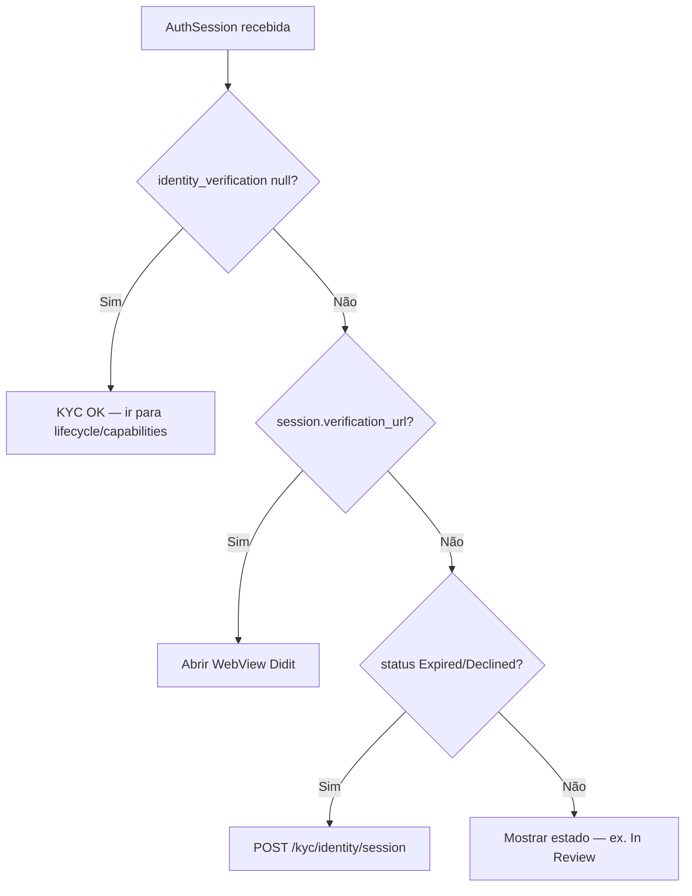

# AuthSession — referência dos campos JSON

## Objetivo

Documentar **cada chave** devolvida em `POST /auth/login`, `POST /auth/register-retail`, `POST /auth/register-corporate` e `POST /auth/login-pin`.

Use esta página como contrato para o front-end e integradores. O backend é a fonte de verdade — não hardcode sequências de onboarding.

## Endpoints que devolvem AuthSession

| Método | Rota |
|--------|------|
| `POST` | `/api/auth/login` |
| `POST` | `/api/auth/register-retail` |
| `POST` | `/api/auth/register-corporate` |
| `POST` | `/api/auth/login-pin` |

## Estrutura de topo

```json
{
  "token": "1|…",
  "user": { … },
  "lifecycle": { … },
  "capabilities": { … },
  "integrations": { … },
  "onboarding": { … },
  "verification": { … },
  "identity_verification": { … } | null
}
```

---

## `token`

| Tipo | Descrição |
|------|-----------|
| `string` | Token Sanctum. Enviar em todas as chamadas autenticadas: `Authorization: Bearer {token}`. |

No login por email/password o token expira em **~10 minutos**. Renove com novo login ou fluxo PIN conforme a vossa app.

---

## `user`

Objecto **Customer** — dados de perfil **sem** flags de onboarding.

| Campo | Tipo | Descrição |
|-------|------|-----------|
| `id` | `integer` | ID interno do customer |
| `name` | `string` | Nome completo |
| `username` | `string` | Identificador único (@handle) |
| `type` | `string` | `retail`, `corporate` ou `responsible` |
| `email` | `string` | Email de login |
| `language` | `string` | Código ISO (ex. `pt`) |
| `currency` | `string` | Moeda preferida (ex. `EUR`) |
| `avatar` | `string` \| `null` | URL ou path do avatar |
| `email_verified_at` | `datetime` \| `null` | Quando o email foi confirmado |
| `phone` | `string` \| `null` | Telefone actual (só dígitos) |
| `created_at` | `datetime` | Registo |
| `updated_at` | `datetime` | Última actualização |

> Para flags de verificação use `verification`, não campos dentro de `user`.

---

## `lifecycle`

Estado **global** da conta — use `lifecycle.status` para decidir o ecrã principal.

| Campo | Tipo | Descrição |
|-------|------|-----------|
| `status` | `string` | Código do ciclo de vida (ver tabela abaixo) |
| `label` | `string` | Texto legível (ex. «Identidade em análise») |
| `is_negative` | `boolean` | `true` = recusa ou bloqueio — mostrar `reason` |
| `reason` | `string` \| `null` | Motivo exposto ao utilizador |

### Valores de `lifecycle.status`

| Valor | Significado |
|-------|-------------|
| `PENDING_EMAIL_VERIFICATION` | Aguarda confirmação de email |
| `PENDING_PHONE_VERIFICATION` | Aguarda SMS |
| `PENDING_IDENTITY_VERIFICATION` | Deve iniciar KYC |
| `IDENTITY_UNDER_REVIEW` | Documentos em análise |
| `IDENTITY_REJECTED` | KYC recusado |
| `PROVISIONING` | A criar contas nos parceiros |
| `PENDING_EBURY_ONBOARDING` | Corporate — documentos Ebury em falta |
| `EBURY_UNDER_REVIEW` | Ebury a analisar |
| `EBURY_REJECTED` | Ebury recusou (conta pode continuar se Wallester OK) |
| `ACTIVE` | Conta activa — wallet / pagamentos |
| `SUSPENDED` | Suspensa |
| `BLOCKED` | Bloqueada (ex. ambos funding partners recusados) |

📖 Detalhe do fluxo: [Ciclo de vida](/docs/guides/onboarding-lifecycle)

---

## `verification`

Resumo rápido das verificações concluídas.

| Campo | Tipo | Descrição |
|-------|------|-----------|
| `email` | `boolean` | Email confirmado |
| `phone` | `boolean` | Telefone actual confirmado por SMS |
| `identity` | `string` | Estado KYC persistido: `PENDING`, `ANALYSING`, `APPROVED`, `DECLINED` |

---

## `onboarding`

Dicas específicas (sobretudo corporate).

| Campo | Tipo | Descrição |
|-------|------|-----------|
| `requires_responsible` | `boolean` | Corporate sem responsável legal registado |
| `message` | `string` \| `null` | Mensagem orientativa para o UI |

---

## `identity_verification`

Verificação de identidade (KYC). Formato **agnóstico ao provedor** — hoje Didit por baixo, mas os nomes JSON não referem Didit.

### Tipo e presença

| Resposta | Tipo JSON | Significado |
|----------|-----------|-------------|
| KYC aprovado | `null` | Nada a fazer — não mostrar fluxo de documentos |
| Estado relevante sem acção | `{ status, session: null }` | Mostrar UI de espera ou retry — **não** abrir URL |
| Utilizador deve actuar | `{ status, session: { … } }` | Abrir `session.verification_url` |

> **Regra principal:** se `identity_verification === null`, ignore KYC no login. Use `verification.identity === APPROVED` como confirmação.

### Diferença entre `verification.identity` e `identity_verification.status`

São camadas diferentes — **não são intercambiáveis**.

| Campo | Origem | O que representa |
|-------|--------|------------------|
| `verification.identity` | `customer.doc_status` persistido | Decisão documental na conta Yoop: `PENDING`, `ANALYSING`, `APPROVED`, `DECLINED` |
| `identity_verification.status` | Sessão KYC actual (provedor) | Estado da **sessão** Didit: `Not Started`, `In Progress`, `In Review`, … |

Exemplos de combinações:

| `verification.identity` | `identity_verification` | Interpretação |
|---------------------------|-------------------------|---------------|
| `PENDING` | `{ status: "In Progress", session: {…} }` | Utilizador a completar KYC |
| `ANALYSING` | `{ status: "In Review", session: null }` | Documentos submetidos — aguardar |
| `APPROVED` | `null` | KYC concluído |
| `DECLINED` | `{ status: "Declined", session: null }` | Recusado — pedir nova sessão |
| `PENDING` | `{ status: "Expired", session: null }` | Sessão expirou — pedir nova sessão |

### Objecto `identity_verification`

| Campo | Tipo | Obrigatório | Descrição |
|-------|------|-------------|-----------|
| `status` | `string` | Sim (quando objecto presente) | Estado da sessão no provedor KYC |
| `session` | `object` \| `null` | Sim | Detalhes da sessão activa; `null` quando não deve abrir URL |

---

### `identity_verification.status` — valores possíveis

Estados **da sessão** (provedor). Capitalização conforme Didit (`In Progress`, não `in_progress`).

| Status | `session` no login | O que mostrar no app | Endpoint útil |
|--------|-------------------|----------------------|---------------|
| `Not Started` | Objecto com URL (se sessão criada) | Botão «Verificar identidade» → WebView | — |
| `In Progress` | Objecto com URL | Retomar fluxo na WebView | — |
| `In Review` | `null` | «Documentos em análise» — **sem** botão Didit | Aguardar webhook |
| `Approved` | `null` (objecto inteiro `null` no login) | Conta verificada | — |
| `Declined` | `null` ou objecto* | «Verificação recusada» + opção de tentar de novo | `POST /kyc/identity/session` |
| `Expired` | `null` | «Sessão expirada» + botão para nova sessão | `POST /kyc/identity/session` |
| `Abandoned` | `null` | Utilizador saiu a meio — oferecer recomeçar | `POST /kyc/identity/session` |

\* `Declined` só inclui `session` se existir sessão activa com `verification_url` válido.

**Estados de sessão vs emails:** webhooks com `Expired` ou `Abandoned` **não** alteram `doc_status` aprovado existente e **não** enviam email de documento.

---

### `identity_verification.session` — campos

Presente **apenas** quando o utilizador deve abrir o fluxo KYC. Formato devolvido no **login** (`AuthSession`):

```json
{
  "id": 12,
  "customer_id": 3,
  "status": "In Progress",
  "external_session_id": "d54203d5-1dee-44c8-bbdb-ebe1fc1418ef",
  "verification_url": "https://verify.didit.me/en/session/…",
  "callback_url": "https://app.example.com/verification-pending",
  "metadata": {
    "application_id": "c159a625-9dde-444c-990d-9accf2298448",
    "session_id": "fdd2191b-ed54-411b-90f7-356265ff865f"
  },
  "created_at": "2026-07-15T10:00:00.000000Z",
  "updated_at": "2026-07-15T10:05:00.000000Z"
}
```

| Campo | Tipo | Descrição |
|-------|------|-----------|
| `id` | `integer` | ID interno Yoop (`customer_didit_sessions.id`) |
| `customer_id` | `integer` | Customer dono da sessão (retail) ou contexto corporate |
| `status` | `string` | Cópia do estado da sessão no provedor |
| `external_session_id` | `string` | ID principal da sessão no Didit (`session_id` na BD) |
| `verification_url` | `string` (URI) | **URL a abrir** em WebView ou browser externo |
| `callback_url` | `string` (URI) \| `null` | URL configurada para retorno após o fluxo (front-end) |
| `metadata` | `object` \| `null` | Metadados extra — ver tabela abaixo |
| `created_at` | `datetime` \| `null` | Criação do registo |
| `updated_at` | `datetime` \| `null` | Última actualização (webhook / criação) |

#### `metadata` — chaves conhecidas

| Chave | Tipo | Descrição |
|-------|------|-----------|
| `application_id` | `string` (UUID) | ID da aplicação/decision Didit — usado em webhooks |
| `session_id` | `string` (UUID) | ID alternativo de sessão nos webhooks (pode diferir de `external_session_id`) |

> Outras chaves podem aparecer conforme evolução do provedor. Tratar `metadata` como objecto opaco se não reconhecer a chave.

---

### Nomes diferentes em `POST /kyc/identity/session`

O endpoint **`POST /api/kyc/identity/session`** devolve formato **legado** (`DiditSessionResource`), **não** o mesmo que o login:

| AuthSession (`identity_verification.session`) | `POST /kyc/identity/session` |
|-----------------------------------------------|------------------------------|
| `external_session_id` | `session_id` |
| `verification_url` | `session_url` |
| `callback_url` | `callback` |
| (não exposto) | `workflow_id` |

**Recomendação:** após criar sessão via API, actualizar o estado local com a resposta ou fazer novo login. Para UI, preferir sempre `verification_url` / `session_url` da resposta mais recente.

---

### Corporate (`type: corporate`)

Ordem de verificação:

1. Se `onboarding.requires_responsible === true` → registar responsável primeiro (`POST /customer/create-corporate-responsible`).
2. KYC do **responsável** (individual) deve estar `APPROVED`.
3. Depois KYB da **empresa** — `identity_verification` reflecte a sessão corporate/Didit KYB.

Enquanto o responsável não concluir KYC, `identity_verification` pode referir-se ao fluxo do responsável (via `onboarding.message`).

---

### `login-pin` vs login password

| Aspecto | Login password | Login PIN |
|---------|----------------|-----------|
| Cria sessão Didit automaticamente | Sim (se KYC pendente) | **Não** — snapshot mínimo |
| `identity_verification.session` | Completo quando aplicável | Pode vir só `status` sem URL |
| Quando URL em falta | — | Chamar `POST /kyc/identity/session` |

`POST /auth/create-pin` e `reset-pin` exigem conta **ACTIVE** (email + KYC). Sem PIN neste device, `login-pin` falha.

---

### Fluxo recomendado no front

```
1. Receber AuthSession
2. Se identity_verification === null → KYC OK
3. Se session?.verification_url → abrir WebView
4. Se session === null e status ∈ {Expired, Abandoned, Declined} → POST /kyc/identity/session
5. Se status === In Review → ecrã de espera (poll GET /customer/me ou aguardar push)
6. Após webhook / utilizador voltar do Didit → refresh login ou GET /customer/me
```

### Quando **não** incluímos `session` (resumo backend)

O backend omite `session` no login quando:

- `verification.identity === APPROVED` → objecto inteiro `null`
- Status da sessão ∈ `Approved`, `Expired`, `Abandoned`
- Status `In Review` (documento já submetido)
- Sessão sem `session_id` nem `session_url` (nada accionável)

---

## `capabilities`

Permissões **derivadas** — preferir estes flags a inferir só pelo `lifecycle`.

| Campo | Tipo | Descrição |
|-------|------|-----------|
| `can_use_platform` | `boolean` | Pode usar a app (não está globalmente bloqueado) |
| `can_transact` | `boolean` | Pode movimentar dinheiro (wallet, P2P, top-up) |
| `can_top_up_stripe` | `boolean` | Top-up Stripe permitido |
| `can_withdraw_wallester` | `boolean` | Levantamentos / cartão Wallester |
| `can_receive_ebury` | `boolean` | Receber transferências Ebury |
| `blockers` | `array` | Bloqueios activos (ver abaixo) |

### Item de `blockers[]`

| Campo | Descrição |
|-------|-----------|
| `scope` | `platform`, `transactions`, `stripe`, `wallester`, `ebury` |
| `reason` | Mensagem legível |
| `source` | Origem (`yoop`, `stripe`, …) |
| `blocked_actions` | Ex. `top_up`, `withdraw`, `receive_transfers`, `fx` |

---

## `integrations`

Mapa com **três chaves fixas**: `stripe`, `wallester`, `ebury`.

Cada entrada segue o mesmo formato:

| Campo | Tipo | Descrição |
|-------|------|-----------|
| `provider` | `string` | `stripe`, `wallester` ou `ebury` |
| `label` | `string` | Nome legível |
| `status` | `string` \| `null` | `PENDING`, `ACTIVE`, `RESTRICTED`, `SUSPENDED`, `FAILED`, `CLOSED`, ou `null` se ainda não provisionado |
| `reason` | `string` \| `null` | Último motivo de estado |
| `source` | `string` \| `null` | Quem alterou (webhook, onboarding, …) |
| `updated_at` | `datetime` \| `null` | Última mudança de estado |
| `blocked_actions` | `string[]` | Acções bloqueadas neste parceiro |
| `iban` | `object` \| `null` | Dados bancários quando existirem |

### `integrations.*.iban`

`null` quando o parceiro ainda não tem IBAN / funding instructions.

**Stripe** (`integrations.stripe.iban`):

| Campo | Descrição |
|-------|-----------|
| `iban` | IBAN para transferência bancária (top-up) |
| `bic` | BIC do banco |
| `account_holder_name` | Titular |
| `country` | País (ex. `DE`) |
| `funding_status` | `ACTIVE`, `PENDING`, `FAILED`, … |
| `bank_transfer_type` | Ex. `eu_bank_transfer` |

**Wallester** (`integrations.wallester.iban`):

| Campo | Descrição |
|-------|-----------|
| `iban` | IBAN da conta |
| `bic` | SWIFT |
| `account_holder_name` | Titular (`receiver_name`) |
| `bank_name` | Nome do banco |
| `viban` | vIBAN alternativo (se diferente) |

**Ebury** (`integrations.ebury.iban`):

| Campo | Descrição |
|-------|-----------|
| `iban` | IBAN Ebury |
| `currency` | Moeda da conta |

---

## Exemplos

### KYC aprovado — conta activa

```json
{
  "lifecycle": { "status": "ACTIVE", "label": "Ativo", "is_negative": false, "reason": null },
  "verification": { "email": true, "phone": true, "identity": "APPROVED" },
  "identity_verification": null,
  "integrations": {
    "stripe": {
      "provider": "stripe",
      "status": "ACTIVE",
      "iban": {
        "iban": "DE89370400440532013000",
        "bic": "COBADEFFXXX",
        "account_holder_name": "John Doe",
        "funding_status": "ACTIVE"
      }
    },
    "wallester": { "provider": "wallester", "status": "ACTIVE", "iban": null },
    "ebury": { "provider": "ebury", "status": "PENDING", "iban": null }
  },
  "capabilities": { "can_transact": true, "can_top_up_stripe": true, "blockers": [] }
}
```

### KYC em curso — abrir Didit

```json
{
  "lifecycle": { "status": "PENDING_IDENTITY_VERIFICATION", "is_negative": false },
  "verification": { "email": true, "phone": true, "identity": "PENDING" },
  "identity_verification": {
    "status": "In Progress",
    "session": {
      "verification_url": "https://verify.didit.me/en/session/…",
      "external_session_id": "abc-123"
    }
  }
}
```

### Documentos em análise — sem URL

```json
{
  "lifecycle": { "status": "IDENTITY_UNDER_REVIEW", "label": "Identidade em análise", "is_negative": false, "reason": null },
  "verification": { "email": true, "phone": true, "identity": "ANALYSING" },
  "identity_verification": {
    "status": "In Review",
    "session": null
  }
}
```

### KYC em curso — sessão completa

```json
{
  "lifecycle": { "status": "PENDING_IDENTITY_VERIFICATION", "is_negative": false },
  "verification": { "email": true, "phone": true, "identity": "PENDING" },
  "identity_verification": {
    "status": "In Progress",
    "session": {
      "id": 12,
      "customer_id": 3,
      "status": "In Progress",
      "external_session_id": "d54203d5-1dee-44c8-bbdb-ebe1fc1418ef",
      "verification_url": "https://verify.didit.me/en/session/abc123",
      "callback_url": "https://yooppayments.eu/verification-pending",
      "metadata": {
        "application_id": "c159a625-9dde-444c-990d-9accf2298448",
        "session_id": "fdd2191b-ed54-411b-90f7-356265ff865f"
      },
      "created_at": "2026-07-15T10:00:00.000000Z",
      "updated_at": "2026-07-15T10:05:00.000000Z"
    }
  }
}
```

### Sessão expirada — pedir nova

```json
{
  "verification": { "identity": "PENDING" },
  "identity_verification": {
    "status": "Expired",
    "session": null
  }
}
```

Chamar `POST /api/kyc/identity/session` para obter novo `session_url` / actualizar via novo login.

### KYC recusado

```json
{
  "lifecycle": { "status": "IDENTITY_REJECTED", "is_negative": true, "reason": "Identidade recusada pelo provedor de verificação." },
  "verification": { "identity": "DECLINED" },
  "identity_verification": {
    "status": "Declined",
    "session": null
  }
}
```

---

## Decisão rápida no front



---

## Relacionado

- [Lógica do sistema](/docs/guides/logica-sistema)
- [Primeiros passos](/docs/guides/getting-started)
- [Ciclo de vida](/docs/guides/onboarding-lifecycle)
- [Conta pronta](/docs/guides/account-ready)
- [API Auth — Scalar](/docs)
