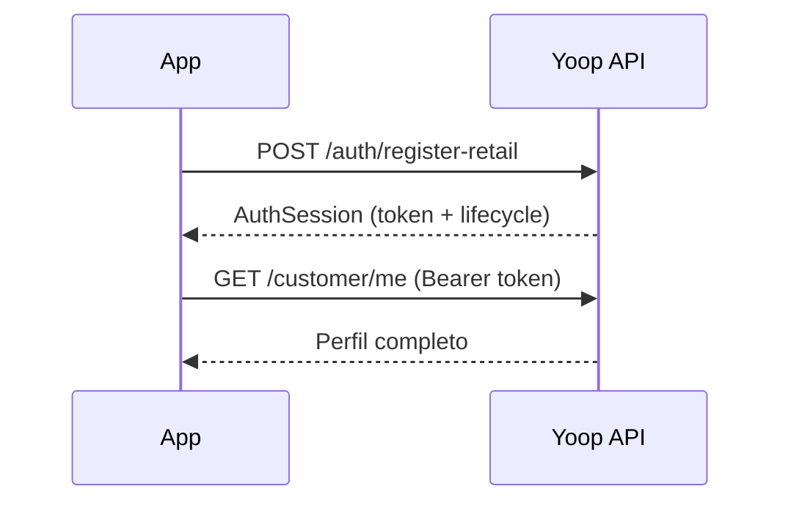

# Primeiros passos

## Objetivo

Autenticar um utilizador e fazer a primeira chamada autenticada à API.

## Base URL

Todas as rotas REST vivem em `/api/{dominio}/*`. Exemplo:

```
POST https://yoop.test/api/auth/login
```

## Fluxo mínimo



## 1. Registo ou login

**Registo retail** — cria conta e devolve sessão:

- `POST /api/auth/register-retail`
- Campos: `name`, `email`, `username`, `password`, `phone`, `currency`

**Login** — se já tem conta:

- `POST /api/auth/login` com `email` + `password`

A resposta **AuthSession** inclui:

| Campo | Uso no front |
|-------|----------------|
| `token` | Guardar e enviar em `Authorization: Bearer {token}` |
| `lifecycle.status` | Ecrã seguinte (email, telefone, KYC…) |
| `capabilities` | O que está permitido agora |
| `integrations` | Estado Ebury / Wallester / Stripe |

📖 **API:** [Auth](/docs) · [Ciclo de vida](/docs/guides/onboarding-lifecycle)

## 2. Chamadas autenticadas

Header obrigatório:

```
Authorization: Bearer {token}
Accept: application/json
```

Exemplo: `GET /api/customer/me` — perfil com flags de verificação.

## 3. Próximos passos típicos

| Estado lifecycle | Acção |
|------------------|--------|
| `PENDING_EMAIL_VERIFICATION` | Validar email (link) ou `POST /customer/send-validation-email` |
| `PENDING_PHONE_VERIFICATION` | `POST /onboarding/phone/send` → `validate` |
| `PENDING_IDENTITY_VERIFICATION` | `POST /kyc/identity/session` → Didit |
| `PROVISIONING` | Aguardar webhooks Ebury/Wallester/Stripe |
| `ACTIVE` | Wallet, top-up, P2P |

## Erros comuns

| HTTP | Causa |
|------|--------|
| 401 | Token em falta ou expirado |
| 403 | Conta ainda não elegível (middleware) |
| 422 | Validação — ver `errors` no body |
