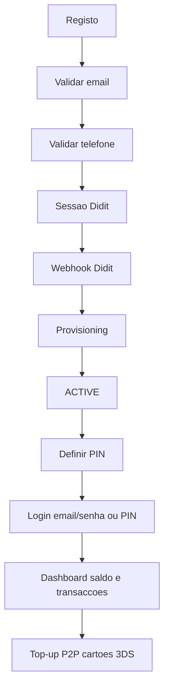
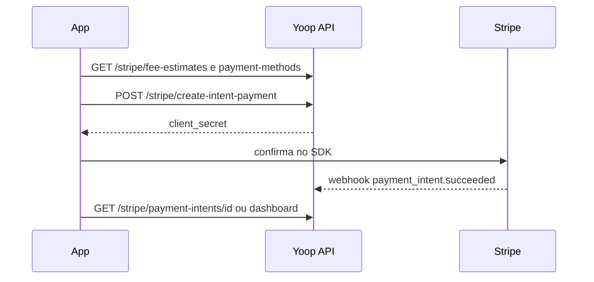
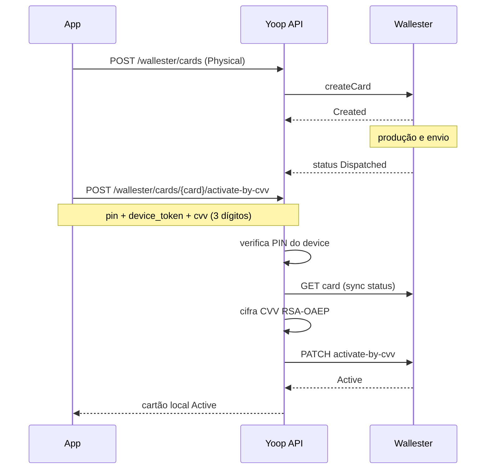
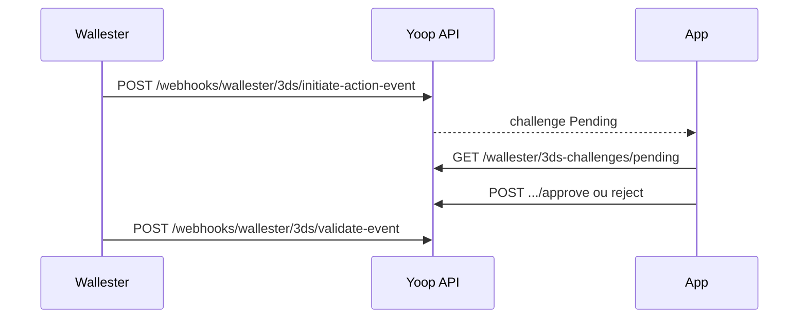
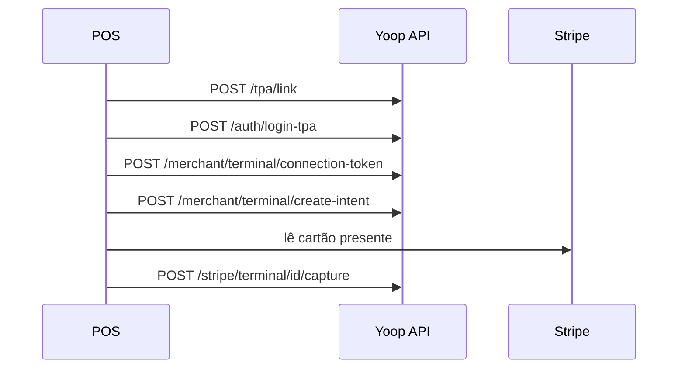

# Lógica do sistema — jornada e endpoints

## Objetivo

Percorrer a conta **do registo até às operações do dia a dia**, na ordem em que o sistema realmente trabalha, e explicar **o que cada endpoint faz** — não só o contrato HTTP.

Este guia é a leitura contínua. Contratos JSON e fluxos isolados:

- [AuthSession — campos JSON](/docs/guides/auth-session)
- [Ciclo de vida](/docs/guides/onboarding-lifecycle)
- [Conta pronta](/docs/guides/account-ready)
- [Top-up com cartão](/docs/guides/topup-card)
- [P2P](/docs/guides/p2p-transfer)
- [Webhooks](/docs/guides/webhooks)
- [Cartões Wallester](/docs/guides/wallester-cards)
- [Compras Wallester](/docs/guides/wallester-card-movements)
- [Recompensas](/docs/guides/referral-rewards)

Não hardcode a sequência no front: a fonte de verdade é `lifecycle`, `capabilities`, `verification` e `identity_verification` devolvidos no login e em `GET /customer/me`.

---

## Como ler cada endpoint

Para cada rota:

| Campo | Significado |
|-------|-------------|
| **Quando** | Ecrã / estado em que a app deve chamar |
| **Pré-requisitos** | Auth, middlewares, PIN, dados já existentes |
| **O que o sistema faz** | Efeitos reais: emails, SMS, jobs, transições |
| **Passo seguinte** | Próxima acção na jornada |

Valores monetários na API estão em **cêntimos**. Token Sanctum de login por password ou PIN expira em **~10 minutos**.

### Tríade de elegibilidade

Wallet, Stripe, Wallester, PIN e notificações exigem **todos**:

- `auth:sanctum` — Bearer token
- `customer.active` — `lifecycle.status === ACTIVE`
- `customer.email.verified`
- `customer.document.approved` — KYC aprovado

Falha → **403**.

### Regra de activação

```
ACTIVE = (Wallester aprovado OU Ebury aprovado) E Stripe pronto
```

Só fica `BLOCKED` se **ambos** os funding partners forem rejeitados.

---

## Visão da jornada



A sequência até ao Didit é a que o utilizador percorre na app. **Criar PIN não vem logo a seguir ao KYC**: o PIN só é aceite com conta `ACTIVE`. Entre a aprovação Didit e o PIN o backend provisiona Wallester/Stripe (e Ebury quando aplicável) via jobs e webhooks.

Depois de `ACTIVE`, as secções **não** seguem o prefixo `/api/{domínio}`: agrupam-se por **fluxo** (top-up cartão, IBAN, P2P, extractos, cartões, 3DS, terminal POS, merchant).

### Estados (`lifecycle.status`)

| Estado | O que a app deve mostrar |
|--------|--------------------------|
| `PENDING_EMAIL_VERIFICATION` | Pedir clique no email (ou reenvio) |
| `PENDING_PHONE_VERIFICATION` | Pedir código SMS |
| `PENDING_IDENTITY_VERIFICATION` | Abrir Didit |
| `IDENTITY_UNDER_REVIEW` | Espera — documentos em análise |
| `IDENTITY_REJECTED` | Recusa + opção de nova sessão |
| `PROVISIONING` | Espera — a criar contas nos parceiros |
| `PENDING_EBURY_ONBOARDING` | Corporate — documentos Ebury em falta |
| `EBURY_UNDER_REVIEW` | Ebury a analisar |
| `EBURY_REJECTED` | Ebury recusou (a conta pode continuar se Wallester OK) |
| `ACTIVE` | Home: saldo, transacções, cartões, P2P |
| `SUSPENDED` / `BLOCKED` | Conta indisponível |

---

## 1. Registo

Cria o customer, dispara o email de validação e **já devolve sessão autenticada**. O lifecycle começa em `PENDING_EMAIL_VERIFICATION`. A app guarda o `token` e usa `lifecycle.status` para o ecrã seguinte.

### `POST /api/auth/register-retail`

**Quando:** primeiro ecrã de criação de conta pessoa singular.

**Pré-requisitos:** nenhum (público). Campos obrigatórios: `name`, `email`, `username`, `password`, `phone`, `currency`. `language` é opcional. `username` só `[a-zA-Z0-9_]`. `phone` só dígitos.

**O que o sistema faz:**

1. Cria o customer com `type = retail` e lifecycle `PENDING_EMAIL_VERIFICATION`.
2. Gera URL assinada de verificação de email.
3. Dispara o evento `UserRegistered` → email de validação em queue (`emails`).
4. Faz auto-login e emite token Sanctum (`password_login`, ~10 min).
5. Devolve `AuthSession`: `token`, `user`, `lifecycle`, `capabilities`, `integrations`, `onboarding`, `verification`, `identity_verification`.

**Passo seguinte:** o utilizador abre o link no email. Se não chegou, `POST /api/customer/send-validation-email` com o token já obtido.

### `POST /api/auth/register-corporate`

**Quando:** criação de conta empresa.

**Pré-requisitos:** nenhum (público). O request valida `username`, `email`, `tax_id`, `password`, `country_code` (`name` opcional).

**O que o sistema faz (intenção):** cria customer `corporate`, envia o mesmo email de validação e devolve `AuthSession`. Depois a jornada corporate pede responsável legal (`POST /api/customer/create-corporate-responsible`), KYC individual do responsável, e só então KyB da empresa (`POST /api/kyc/identity/session`).

**Nota de implementação:** o DTO de registo partilhado exige `phone` e **não mapeia** `tax_id` / `country_code`. O pedido OpenAPI/Postman corporate e o DTO actual não estão alinhados — o NIF/país podem não persistir neste passo.

**Passo seguinte:** verificar email; mais tarde criar o responsável.

---

## 2. Email

O email é o primeiro gate. Sem `email_verified_at` o lifecycle não avança para telefone. O clique **não passa pela API REST autenticada**: é um link assinado no browser / WebView.

### `GET /email/verify/{id}/{hash}`

**Quando:** o utilizador abre o link recebido no email.

**Pré-requisitos:** URL assinada Laravel (`expires` + `signature`), válida ~60 minutos. Sem Bearer token. A URL enviada aponta para o frontend (`app.url_frontend`), que deve encaminhar o mesmo path para a API ou tratar o JSON se `Accept: application/json`.

**O que o sistema faz:**

1. Confirma `id` + `hash === sha1(email)`.
2. Se já estava verificado → `already_verified` (409).
3. Marca `email_verified_at`.
4. Se o lifecycle era `PENDING_EMAIL_VERIFICATION` → `PENDING_PHONE_VERIFICATION`.

HTML (`auth.email-verification-result`) ou JSON, conforme `Accept`.

**Passo seguinte:** com o token do registo, `POST /api/onboarding/phone/send`.

### `POST /api/customer/send-validation-email`

**Quando:** o email não chegou, expirou, ou o utilizador pede reenvio.

**Pré-requisitos:** `auth:sanctum`. Não exige a tríade (a conta ainda não é `ACTIVE`).

**O que o sistema faz:** gera nova URL assinada e envia `ValidationEmail` **na hora** (não via queue). Resposta `{ "message": "Validation email sent." }`.

**Passo seguinte:** o utilizador volta a abrir o link.

---

## 3. Telefone

No **onboarding** o número começa no registo, mas o utilizador pode **corrigir** um número mal digitado enquanto ainda não está verificado. O SMS prova o número que está na conta no momento do envio. Depois de verificado, mudar o telefone é outro par de endpoints (`/customer/phone`) — dois passos, o perfil só actualiza após o código.

### `POST /api/onboarding/phone/send`

**Quando:** `lifecycle.status === PENDING_PHONE_VERIFICATION` (primeiro envio, reenvio, ou correcção).

**Pré-requisitos:** `auth:sanctum`. Body opcional: `phone` (só dígitos).

**O que o sistema faz:**

1. Sem `phone` (ou com o mesmo número da conta) → envia o OTP para `$customer->phone`.
2. Com um `phone` **diferente** e o número actual **ainda não verificado** → actualiza `customer.phone` (correcção) e envia o SMS para o novo número.
3. Com um `phone` diferente mas o actual **já verificado** → **422** (`phone_already_verified`): usar `POST /api/customer/phone`.
4. Se o telefone da conta já está verificado e se pede reenvio → `status: failed`, «Phone already verified.»
5. Gera código de 6 dígitos (TTL ~10 min) e grava `PhoneVerification`. Se o gateway SMS ou WhatsApp falhar, apaga o registo e responde **424** com `status: failed`.

A resposta de sucesso inclui `phone` com o número para o qual o SMS foi enviado.

**Passo seguinte:** ecrã a pedir o código → `POST /api/onboarding/phone/validate`.

### `POST /api/onboarding/phone/validate`

**Quando:** o utilizador introduz o OTP.

**Pré-requisitos:** `auth:sanctum`. Body: `code`.

**O que o sistema faz:** compara o código (não expirado, ainda não usado). Marca `verified_at`. Se o lifecycle era `PENDING_PHONE_VERIFICATION` → `PENDING_IDENTITY_VERIFICATION`. Código inválido → **422**.

**Passo seguinte (retail):** `POST /api/kyc/identity/session`. Corporate: garantir responsável legal antes do KyB.

### `POST /api/customer/phone`

**Quando:** conta já existente quer **alterar** o número (não é o onboarding).

**Pré-requisitos:** `auth:sanctum`. Body: `phone` (o novo número).

**O que o sistema faz:** dispara SMS de confirmação para o número pedido, sem substituir ainda o telefone da conta.

**Passo seguinte:** `POST /api/customer/phone/confirm`.

### `POST /api/customer/phone/confirm`

**Quando:** o utilizador confirma o código da mudança de número.

**Pré-requisitos:** `auth:sanctum`. Body: `phone` + `code`.

**O que o sistema faz:** valida o OTP e **só então** actualiza `customer.phone`.

---

## 4. Didit (KYC / KyB)

A app nunca «aprova» documentos. Abre a sessão, o utilizador completa o fluxo no Didit, e a Yoop só muda de estado quando chega o webhook.

### `POST /api/kyc/identity/session`

**Quando:** `PENDING_IDENTITY_VERIFICATION`, sessão expirada/abandonada/recusada, ou login-pin sem `verification_url`.

**Pré-requisitos:** `auth:sanctum`.

- Retail → workflow KYC individual.
- Corporate → KyB da empresa; **exige responsável com KYC já `APPROVED`**. Se `onboarding.requires_responsible === true`, primeiro `POST /api/customer/create-corporate-responsible`.

**O que o sistema faz:** cria ou reutiliza sessão Didit (recria se `Declined` / `Abandoned` / `Expired` ou com mais de 7 dias). Devolve formato legado: `session_id`, `session_url`, `status`, `workflow_id`, `callback` (frontend `/verification-pending`). A app abre `session_url` em WebView.

O login por password também pode **criar/reutilizar** sessão automaticamente e devolvê-la em `identity_verification.session` (aí o campo chama-se `verification_url`). Não são o mesmo JSON — mapear conforme o guia AuthSession.

**Passo seguinte:** utilizador no Didit. A app espera (poll `GET /customer/me` ou push). **Não** chamar `create-pin` ainda.

### `POST /api/webhooks/didit`

**Quando:** o Didit notifica a Yoop (a app **não** chama isto).

**Pré-requisitos:** assinatura `X-Signature-V2`. Sem Sanctum.

**O que o sistema faz:**

1. Valida a assinatura (401 se inválida).
2. Enfileira `ProcessIdentityVerificationWebhook` (`didit-webhooks`).
3. Responde de imediato `{ "success": true }`.

No job (KYC individual / responsável):

- Actualiza `doc_status` e lifecycle (`PENDING_IDENTITY` / `UNDER_REVIEW` / `REJECTED` / `PROVISIONING`).
- Email de estado do documento; SMS em alguns estados.
- Se **Approved** → `FinancialProvisioningService` dispara provisionamento dos parceiros de funding.
- Upload de media dos documentos em job separado.

KyB corporate actualiza o documento da empresa e o `doc_status`; o path KyB actual **não** dispara o mesmo `transitionTo(PROVISIONING)` / `dispatchPostKycPartners` que o KYC individual.

**Passo seguinte (retail aprovado):** ecrã `PROVISIONING` até `ACTIVE`.

### `POST /api/customer/create-corporate-responsible`

**Quando:** conta `corporate` sem representante legal (`onboarding.requires_responsible`).

**Pré-requisitos:** `auth:sanctum`. Body típico: `name`, `username`, `email`.

**O que o sistema faz:** cria ou actualiza o customer `responsible` ligado à empresa. O KYC que se segue é o **do responsável** (pessoa), não o da empresa.

**Passo seguinte:** sessão Didit do responsável; depois KyB da empresa.

---

## 5. Depois do KYC — provisioning (a app não chama)

Com identidade aprovada o backend cria contas nos parceiros. O utilizador só observa.

O que corre sem endpoint de customer:

- Job de funding partners: **Wallester** (Ebury está desactivado no código até estar pronto).
- Webhooks `POST /api/webhooks/wallester`, `/stripe` (e `/ebury` quando Ebury voltar a ser usado) a confirmar estados.
- Quando um funding partner está OK **e** o Stripe está pronto → lifecycle `ACTIVE`.

**Como a app sabe:** novo `POST /auth/login` (ou `login-pin`) ou `GET /api/customer/me`. Enquanto `PROVISIONING`, `capabilities.can_transact` é `false` — wallet/PIN devolvem 403.

---

## 6. PIN

O PIN vive no **dispositivo** (`device_token`), não na conta. Sem PIN criado neste device não há `login-pin` nem P2P / acções de cartão que pedem PIN.

**Gate:** tríade completa. Chamar isto com lifecycle ainda `PROVISIONING` ou KYC pendente → **403**.

### `POST /api/auth/create-pin`

**Quando:** primeira vez neste device, conta já `ACTIVE`.

**Pré-requisitos:** Bearer + tríade. Body: `device_token` (único), `device_name`, `pin` (4 dígitos).

**O que o sistema faz:** hash do PIN e upsert em `customer_devices`. **201** `{ "message": "PIN created successfully" }`.

**Passo seguinte:** daqui em diante a app pode usar `login-pin` neste device e operações que exigem PIN.

### `POST /api/auth/reset-pin`

**Quando:** o utilizador quer mudar o PIN no mesmo device.

**Pré-requisitos:** Bearer + tríade. Body: `device_token`, novo `pin`, e **ou** `current_pin` **ou** `password` (mutuamente exclusivos).

**O que o sistema faz:** valida a prova, grava o novo hash. Cinco falhas bloqueiam o device (`blocked_at`); o próximo `login-pin` devolve **423**.

---

## 7. Login e sessão (app)

Depois do onboarding (e no dia a dia), a **app** entra por password ou PIN. Ambos devolvem `AuthSession` — o PIN traz um snapshot mais leve e **não cria** sessão Didit nova.

Login de **terminal POS** não é aqui: ver [Terminal / POS](#15-terminal--pos).

### `POST /api/auth/login`

**Quando:** ecrã email + senha (onboarding a meio ou conta já activa).

**Pré-requisitos:** público. Body: `email`, `password`.

**O que o sistema faz:** autentica, emite token ~10 min (`password_login`), resolve onboarding (pode criar/reutilizar sessão Didit se KYC pendente) e devolve `AuthSession` completo.

**Passo seguinte:** ler `lifecycle.status`. Se `ACTIVE` e ainda não há PIN neste device → `create-pin`. Se KYC pendente com `identity_verification.session.verification_url` → abrir Didit.

### `POST /api/auth/login-pin`

**Quando:** unlock da app neste device (já existe PIN).

**Pré-requisitos:** público. Body: `email`, `pin`, `device_token`. Device bloqueado → **423**.

**O que o sistema faz:** valida PIN do device, token ~10 min (`device_pin_login_*`). `identity_verification` vem em modo mínimo — **sem** criar URL Didit. Se faltar URL, a app chama `POST /kyc/identity/session`.

**Passo seguinte:** home (`GET /wallet/dashboard`) se `ACTIVE`.

### `POST /api/auth/logout`

**Quando:** o utilizador sai.

**Pré-requisitos:** `auth:sanctum`.

**O que o sistema faz:** apaga **todos** os tokens Sanctum do customer (não só o actual). `{ "message": "Logged out successfully" }`.

### `POST /api/auth/forgot-password`

**Quando:** «esqueci a senha».

**Pré-requisitos:** público. Body: `email` (tem de existir em `customers`).

**O que o sistema faz:** cria token em `password_reset_tokens` e envia email (job). O link abre a página web `GET /password/reset?email=&token=`.

### `POST /api/auth/reset-password`

**Quando:** a app (ou um cliente API) aplica o token do email sem passar pela página web.

**Pré-requisitos:** público. Body: `email`, `token`, `password` + `password_confirmation` (min 8).

**O que o sistema faz:** redefine a password. Se o email ainda não estava verificado, marca `email_verified_at` — **sem** avançar o lifecycle por si só. Alternativa web: `POST /password/reset` e `GET /password/reset/success`.

---

## 8. Dashboard — saldo e conta

Home da app depois de `ACTIVE`. Rotas `/api/wallet/*` usam a tríade.

### `GET /api/wallet/dashboard`

**Quando:** ecrã inicial autenticado.

**Pré-requisitos:** Bearer + tríade.

**O que o sistema faz:** junta saldos (`customer_balances`, por moeda: `available` + `pending`) com as transacções recentes do ledger Yoop. Resposta:

```json
{
  "balances": [{ "currency": "EUR", "available": 12500, "pending": 300 }],
  "transactions": [ /* movimentos recentes */ ]
}
```

**Passo seguinte:** detalhe de uma transacção, top-up, P2P, ou cartões — conforme o tap do utilizador.

### `GET /api/wallet/dashboard/summary`

**Quando:** o mesmo ecrã. Alias do anterior — **mesma lógica e mesma resposta**.

### `GET /api/wallet/account/balance`

**Quando:** só precisa dos saldos (widget, pull-to-refresh de totais).

**Pré-requisitos:** Bearer + tríade. Query opcional `currency`.

**O que o sistema faz:** lê `customer_balances`. Lista `{ currency, available, pending }`.

### `GET /api/wallet/account`

**Quando:** ecrã «a minha conta» / dados bancários.

**Pré-requisitos:** Bearer + tríade.

**O que o sistema faz:** devolve o detalhe local Stripe (customer id, funding IBAN/BIC/vIBAN, status) e Wallester (id, IBAN, balance, `available_amount`, status). Para IBANs no login, preferir também `integrations.*.iban` no `AuthSession`.

### `POST /api/wallet/account/wallester/sync`

**Quando:** o saldo Wallester na app parece desactualizado.

**Pré-requisitos:** Bearer + tríade. Query opcional `currency`.

**O que o sistema faz:** chama a API Wallester, persiste o saldo local e devolve `{ wallester: {…} }`. **422** se a conta de funding ainda não estiver operacional.

---

## 9. Top-up com cartão

Carregar a wallet com cartão (Stripe). O saldo **não** aparece neste pedido: a app confirma no SDK; o crédito chega pelo webhook (pendente, depois `available` ~D+2).

Guia: [Top-up com cartão](/docs/guides/topup-card).



### `GET /api/stripe/payment-methods`

**Quando:** ecrã de top-up, antes de escolher método.

**Pré-requisitos:** Bearer + tríade. Query `currency` (ex. `EUR`).

**O que o sistema faz:** métodos activos + fees (cache ~5 min): `id`, `payment_method`, `label`, fees Stripe/plataforma.

### `GET /api/stripe/fee-estimates`

**Quando:** UI «quanto custa carregar».

**Pré-requisitos:** Bearer + tríade. Query `currency`.

**O que o sistema faz:** a mesma fonte de fees, formatada para estimativas.

### `POST /api/stripe/create-intent-payment`

**Quando:** o utilizador escolheu método e valor.

**Pré-requisitos:** Bearer + tríade, conta Stripe provisionada, header `Idempotency-Key`, throttle `stripe-intent` (10/min). Body: `amount`, `payment_method_id`, `currency?`.

**O que o sistema faz:** cria PaymentIntent na Stripe (purpose top-up), grava `stripe_payment_intents`, devolve `payment_intent` + `client_secret`. **Ainda não cria** `stripe_transactions` nem credita saldo.

**Passo seguinte:** confirmar no SDK Stripe; poll `GET /stripe/payment-intents/{id}` ou o dashboard.

### `GET /api/stripe/payment-intents/{id}`

**Quando:** poll após o SDK / regresso do 3DS Stripe.

**Pré-requisitos:** Bearer + tríade; o intent é do customer. Quando o webhook ligar, inclui `stripe_transaction_id` / `transaction`.

Webhook que fecha o ciclo: `POST /api/webhooks/stripe` (secção 19).

---

## 10. Top-up por transferência (IBAN)

Carregar a wallet por transferência bancária para o vIBAN Stripe. Não misturar com o terminal POS.

### `POST /api/stripe/create-funding`

**Quando:** o utilizador quer IBAN para carregar por transferência.

**Pré-requisitos:** Bearer + tríade; throttle `stripe-intent`.

**O que o sistema faz:** cria ou retenta funding instructions Stripe (EUR → `eu_bank_transfer`, etc.) e persiste IBAN/BIC no `stripeAccount`.

### `GET /api/stripe/get-funding-instructions`

**Quando:** mostrar de novo o IBAN já gerado.

**Pré-requisitos:** Bearer + tríade. **404** se ainda não houver conta Stripe / instruções.

Os dados IBAN também aparecem em `GET /wallet/account` e em `integrations.stripe.iban` no login.

---

## 11. P2P — enviar a outro utilizador

Enviar dinheiro pelo `username`. O dinheiro move-se no parceiro de funding (Wallester), não só no ledger local.

Guia: [P2P](/docs/guides/p2p-transfer).

```
GET /customer/find/{username}  (ou GET /customer/favorites)
        → POST /wallet/transactions/p2p  (PIN + Idempotency-Key)
```

### `GET /api/customer/find/{username}`

**Quando:** o utilizador está a escolher destinatário.

**Pré-requisitos:** `auth:sanctum`. `username` alfanumérico + `_`. Não devolve o próprio.

**O que o sistema faz:** lookup público só de contas **ACTIVE** com KYC aprovado (`name`, `username`, `avatar_url`). Sem dados sensíveis.

### `GET /api/customer/favorites`

**Quando:** lista rápida de destinatários habituais.

**Pré-requisitos:** `auth:sanctum`.

**O que o sistema faz:** favoritos públicos e activos. Um P2P com `favorite: true` pode acrescentar aqui.

### `POST /api/customer/favorites`

**Quando:** guardar um destinatário sem fazer transferência.

**Pré-requisitos:** `auth:sanctum`. Body: `username`.

**O que o sistema faz:** valida que o username existe, está `ACTIVE` com KYC aprovado, e não é o próprio. Idempotente.

### `DELETE /api/customer/favorites/{username}`

**Quando:** remover um favorito.

**Pré-requisitos:** `auth:sanctum`.

**O que o sistema faz:** apaga o vínculo. Idempotente se já não for favorito. Permite limpar contas que deixaram de estar activas.

### `POST /api/wallet/transactions/p2p`

**Quando:** enviar o valor.

**Pré-requisitos:** Bearer + tríade + PIN neste `device_token`. Header `Idempotency-Key`. Body: `recipient_username`, `amount`, `currency`, `pin`, `device_token`, `description?`, `favorite?`.

**O que o sistema faz:**

1. Valida o PIN do dispositivo.
2. Recusa contas `platform` como destinatário.
3. Transfere no parceiro de funding (Wallester account→account).
4. Cria o par débito/crédito no ledger (`P2P_SEND` / `P2P_RECEIVE`).
5. Opcionalmente grava favorito.

**201** `{ debit, credit }`.

---

## 12. Extractos

Três listas diferentes — não misturar:

| Fonte | Endpoint | O que é |
|-------|----------|---------|
| Ledger Yoop (top-up, P2P, …) | `GET /wallet/transactions` | `stripe_transactions` |
| Movimentos unificados da conta funding | `GET /wallet/funding-accounts/{id}/movements` | compras cartão + FX + P2P — **canónico na app** |
| Live Wallester | `GET /wallester/transactions` | passthrough do parceiro |

### `GET /api/wallet/transactions`

**Quando:** lista de movimentos da wallet Yoop (não o extrato de cartão).

**Pré-requisitos:** Bearer + tríade.

**O que o sistema faz:** pagina o ledger. Cada item traz `type`, `direction`, `amount`, `fee`, `net_amount`, `status`, `counterparty` (P2P), `bank_transfer`, `partner_funding_status` (top-up), `settles_at`.

### `GET /api/wallet/transactions/{id}`

**Quando:** detalhe de um movimento do ledger.

**Pré-requisitos:** Bearer + tríade; o `id` pertence ao customer.

### `GET /api/wallet/funding-accounts/{id}/movements`

**Quando:** extrato da conta de funding / cartão na app Yoop.

**Pré-requisitos:** Bearer + tríade; `{id}` é uma `CustomerWallesterAccount` do customer, operacional. Query `per_page`.

**O que o sistema faz:** lista `funding_partner_movements` visíveis (compras, reembolsos, P2P, transfers, envios Wise). O `amount` já inclui FX quando aplicável; há `original_amount` / `original_currency`, `fees_amount`, `platform_fees_amount`, `type`, `direction`, `is_p2p`, `counterparty`, `status`, `status_label`, `description`.

Um envio Wise aparece aqui pelo espelho interno (`idempotency_key` `wise_mirror:…`), mas a resposta já vem normalizada: `provider` `wise`, `source_label` `Wise`, `type_label` `Transferência Wise`. O `status` **não** é o estado cru da Wise (`outgoing_payment_sent`, etc.).

A linha entra na lista assim que a transferência Wise é criada, inclusive em `incoming_payment_waiting`. Nesse caso `status` é `pending` e `status_label` é `A caminho da Wise`. Não fica de fora à espera do débito na Wallester.

Enum `CustomerMovementStatus`. A app mostra `status_label` e usa `status` para a cor.

| Estado Wise | `status` | `status_label` |
|---|---|---|
| `incoming_payment_waiting`, `incoming_payment_initiated` | `pending` | A caminho da Wise |
| `processing`, `funds_converted` | `processing` | Em processamento |
| `outgoing_payment_sent` | `sent` | Pagamento enviado |
| `cancelled` | `canceled` | Pagamento cancelado |
| `funds_refunded` | `refunded` | Pagamento reembolsado |
| `charged_back` | `charged_back` | Valor devolvido ao remetente |
| `bounced_back` | `bounced_back` | Devolvido |
| `unknown` | `unknown` | Estado desconhecido |

Movimentos Wallester (e o resto) usam só `pending`, `completed`, `failed` e `canceled`, com `status_label` `Pendente`, `Concluído`, `Falhou` e `Cancelado`. `sent` é pagamento Wise já enviado, não é `completed`.

A app mostra `status_label`. O formato do item é o mesmo; muda `status` / `status_label` (e, na Wise, `provider` e `source_label`).

Wise pendente:

```json
{
  "id": 387,
  "provider": "wise",
  "direction": "out",
  "type": "account_transfer",
  "type_label": "Transferência Wise",
  "source_label": "Wise",
  "is_p2p": false,
  "amount": 50,
  "currency": "EUR",
  "status": "pending",
  "status_label": "A caminho da Wise",
  "description": "Maria Silva · REF123",
  "failure_reason": null,
  "created_at": "2026-10-20T15:08:20+01:00"
}
```

Wise pagamento enviado:

```json
{
  "id": 385,
  "provider": "wise",
  "direction": "out",
  "type": "account_transfer",
  "type_label": "Transferência Wise",
  "source_label": "Wise",
  "is_p2p": false,
  "amount": 35,
  "currency": "EUR",
  "status": "sent",
  "status_label": "Pagamento enviado",
  "description": "Maria Silva · REF123",
  "failure_reason": null,
  "created_at": "2026-10-19T15:52:51+01:00"
}
```

Os outros estados Wise usam o mesmo corpo. Só mudam `status` e `status_label`: `processing` / `Em processamento`, `canceled` / `Pagamento cancelado`, `refunded` / `Pagamento reembolsado`, `charged_back` / `Valor devolvido ao remetente`, `bounced_back` / `Devolvido`, `unknown` / `Estado desconhecido`.

Wallester concluído:

```json
{
  "id": 210,
  "provider": "wallester",
  "direction": "out",
  "type": "card_purchase",
  "type_label": "Compra cartão",
  "source_label": "Wallester",
  "is_p2p": false,
  "amount": 463,
  "currency": "EUR",
  "original_amount": 388,
  "original_currency": "GBP",
  "fees_amount": 9,
  "status": "completed",
  "status_label": "Concluído",
  "description": "LidlGB",
  "failure_reason": null,
  "created_at": "2026-10-18T12:04:25+01:00"
}
```

Wallester pendente, falhado e cancelado usam o mesmo corpo de transferência, com `status` / `status_label`: `pending` / `Pendente`, `failed` / `Falhou` (`failure_reason` preenchido), `canceled` / `Cancelado`.

Os exemplos completos, um por estado, estão na referência da API em `GET /wallet/funding-accounts/{id}/movements`.

Guia: [Compras Wallester e câmbio](/docs/guides/wallester-card-movements).

### `GET /api/wallester/transactions`

**Quando:** extrato **live** do parceiro (debug / reconciliação), não o ecrã principal da app.

**Pré-requisitos:** Bearer + tríade. Conta Wallester `ACTIVE`. Query: `from_record`, `records_count`, `from_date`, `to_date`, `card_id?`.

### `GET /api/wallester/transactions/{transaction}`

**Quando:** detalhe live de um uuid Wallester, com check de ownership.

---

## 13. Cartões Wallester

Emissão e gestão do cartão. Exigem tríade. Criar / activar-por-CVV / bloquear / desbloquear / fechar pedem PIN do **device Yoop** (não o PIN do cartão, excepto `encrypted-pin`).

Guia: [Cartões Wallester](/docs/guides/wallester-cards).

Compras online com 3DS: secção seguinte. Extrato de gastos: [Extractos](#12-extractos).

### Estados e acções na app

| Status | O que a app mostra |
|--------|-------------------|
| `Active` | Revelar dados (`sensitive` / `encrypted-pin`), congelar (`block`), fechar (`close`) |
| `Blocked` | Revelar dados, descongelar (`unblock`), fechar (`close`) |
| `Dispatched` | Só activar com CVV impresso (`activate-by-cvv`: PIN + CVV) |
| `Created` (físico) | Pendente de envio — sem acções de gestão |
| `Closed` / `Closing` | Nenhuma acção |

Cartão **Virtual** em `Created` activa-se com `POST .../activate` (a criação já o faz automaticamente). Cartão **Physical** só fica `Active` depois de `activate-by-cvv`.



### `GET /api/wallester/accounts`

**Quando:** listar contas de cartão/IBAN no parceiro (live).

**O que o sistema faz:** passthrough `listAccounts` (pagina até ao fim).

### `GET /api/wallester/accounts/{account}`

**Quando:** detalhe de uma conta Wallester (`uuid`).

**O que o sistema faz:** `getAccount` live.

### `GET /api/wallester/cards/issuance-quote`

**Quando:** antes de emitir, para mostrar preço.

**O que o sistema faz:** fees virtual/physical + `will_charge` (virtual só cobra se **já** existir cartão aberto).

### `POST /api/wallester/cards`

**Quando:** o utilizador confirma a emissão.

**Pré-requisitos:** PIN + `device_token`. Body: `type` (`Virtual` \| `Physical`), `name`, `pin`, `device_token`, `limits?`, `security?`. `delivery_address` obrigatório se Physical.

**O que o sistema faz:** cria o cartão no Wallester, cobra fee se `will_charge`, e se for virtual em estado `Created` **activa logo**. Físico fica `Created` até ser enviado e activado por CVV.

### `GET /api/wallester/cards`

**Quando:** lista «os meus cartões».

**O que o sistema faz:** cartões `managed()` locais do customer (`Active`, `Created`, `Blocked`, `Dispatched`, `Closed`) — não um dump live completo.

### `GET /api/wallester/cards/{card}`

**Quando:** detalhe de um cartão (ownership).

**O que o sistema faz:** detalhe live Wallester (passthrough). Usar o `status` desta resposta para decidir os botões de gestão.

### `POST /api/wallester/cards/{card}/activate`

**Quando:** cartão **Virtual** ainda não activo (se a criação não o activou). Idempotente se já `Active`. Physical não é suportado aqui.

### `POST /api/wallester/cards/{card}/activate-by-cvv`

**Quando:** cartão físico recebido (`Dispatched`, também `Created` / `Personalized`), para activar com o CVV impresso.

**Pré-requisitos:** PIN do device + `device_token` + `cvv` (3 dígitos em claro). Tipos: `Physical`, `ChipAndPin`, `ChipAndPinAnonymous`.

**O que o sistema faz:** sincroniza o status local (`GET card`), cifra o CVV com RSA-OAEP SHA-256 (label vazio) com `wallester.rsa_public_key`, envolve em `BEGIN/END MESSAGE`, envia o PEM em Base64 à Wallester (`PATCH activate-by-cvv`) e grava `Active`. Idempotente se já estiver `Active`.

**Não usar** em `Blocked` / `Closed` — isso não é descongelar. Descongelar é `POST .../unblock`.

### `POST /api/wallester/cards/{card}/sensitive`

**Quando:** mostrar PAN + CVV na app.

**Pré-requisitos:** password **ou** PIN+device. Cartão `Active` **ou** `Blocked`. O servidor desencripta e devolve os dados — tratar como ecrã sensível.

### `POST /api/wallester/cards/{card}/encrypted-pin`

**Quando:** revelar o PIN do **cartão** (não o PIN da app).

**Pré-requisitos:** iguais a `sensitive`.

### `POST /api/wallester/cards/{card}/block`

**Quando:** congelar um cartão `Active`. Exige PIN do device. Idempotente se já `Blocked`.

### `POST /api/wallester/cards/{card}/unblock`

**Quando:** descongelar um cartão `Blocked`. Exige PIN. Idempotente se já `Active`.

### `POST /api/wallester/cards/{card}/close`

**Quando:** encerrar (`Closed` / `Closing`) um cartão `Active` ou `Blocked`. Exige PIN. Irreversível do ponto de vista de produto. Depois disto, nenhuma acção de gestão.

---

## 14. 3DS (compra online com cartão)

Fluxo completo: Wallester inicia o desafio por webhook → a app lista e aprova/rejeita → Wallester pergunta se já há decisão.



### `GET /api/wallester/3ds-challenges/pending`

**Quando:** o utilizador abre a app após push de compra online, ou o ecrã de desafios.

**Pré-requisitos:** Bearer + tríade.

**O que o sistema faz:** desafios `Pending` ainda não expirados (`merchant`, `transaction`, `card`, `expires_at`, …).

### `POST /api/wallester/3ds-challenges/{challenge}/approve`

**Quando:** o utilizador confirma a compra. A Yoop marca approved; o Wallester confirma depois via webhook 3DS.

### `POST /api/wallester/3ds-challenges/{challenge}/reject`

**Quando:** o utilizador recusa a compra.

### `POST /api/webhooks/wallester/3ds/initiate-action-event`

**Quando:** o Wallester inicia um desafio (a app **não** chama). Middleware `wallester.3ds.webhook`.

**O que o sistema faz:** cria o challenge `Pending` para a app.

### `POST /api/webhooks/wallester/3ds/validate-event`

**Quando:** o Wallester pergunta se o utilizador já aprovou/rejeitou. Fecha o ciclo do desafio.

---

## 15. Terminal / POS

Um único fluxo: emparelhar o equipamento, abrir sessão, criar o pagamento no Stripe Terminal e capturar. **Não** é o top-up da wallet na app.

Há **três autenticações** distintas — não misturar:

| Passo | Quem chama | Auth |
|-------|------------|------|
| Pairing e login TPA | Terminal / operador | email + password (+ serial) |
| Connection token e create-intent | POS com API key | `X-Merchant-Key` (`auth.merchant`) |
| Capture | App / backend do customer | Bearer Sanctum + tríade |



Guias: [Terminal](/docs/partners/guides/terminal-topup).

### `POST /api/tpa/link`

**Quando:** primeira configuração do terminal físico.

**Pré-requisitos:** público. Body: `email`, `password`, `tpa_serial` (único, ainda não ligado).

**O que o sistema faz:** autentica o customer, associa o serial com status `active`, devolve token + dados do TPA.

**Passo seguinte:** `POST /api/auth/login-tpa` nas sessões seguintes.

### `POST /api/auth/login-tpa`

**Quando:** o terminal já está ligado e precisa de sessão.

**Pré-requisitos:** público. Body: `email`, `password`, `tpa_serial`. O TPA tem de estar `active`.

**O que o sistema faz:** emite token **sem** expiry explícito (`tpa_login_{serial}`). Resposta `TpaAuthResource`: `token`, `context: tpa`, `user`, `tpa { id, serial, status }` — **não** é o `AuthSession` da app.

### `POST /api/merchant/terminal/connection-token`

**Quando:** o SDK Stripe Terminal no POS precisa de se ligar.

**Pré-requisitos:** `X-Merchant-Key`. Throttle `merchant-terminal-token` (60/min por merchant).

**O que o sistema faz:** devolve um connection token Stripe Terminal.

### `POST /api/merchant/terminal/create-intent`

**Quando:** iniciar um pagamento com cartão presente.

**Pré-requisitos:** `X-Merchant-Key`, header `Idempotency-Key`. Throttle `merchant-terminal-intent` (60/min por merchant).

**O que o sistema faz:** cria PaymentIntent `card_present`.

**Passo seguinte:** o POS lê o cartão no Stripe; depois `POST /api/stripe/terminal/{id}/capture`.

### `POST /api/stripe/terminal/{paymentIntent}/capture`

**Quando:** capturar o PaymentIntent depois do cartão presente.

**Pré-requisitos:** Bearer **customer** + tríade (não é a API key merchant). Throttle `stripe-intent`. O `{paymentIntent}` é o id interno Yoop, já criado no passo anterior.

**O que o sistema faz:** captura o PI se estiver capturável. `{ "message": "Captura solicitada com sucesso." }`.

---

## 16. Merchant (o customer como loja)

Registo da loja, credenciais e links de pagamento. Rotas com Bearer do **customer** usam só `auth:sanctum` — **não** a tríade. Terminal POS está na [secção 15](#15-terminal--pos).

O grupo com `X-Merchant-Key` serve o POS / integrador (criar payment request sem ser o dono na app).

Guia: [Payment requests](/docs/partners/guides/payment-requests).

### `GET /api/merchant`

Lista os merchants do customer autenticado.

### `POST /api/merchant/register`

Cria merchant e gera `api_key` + `webhook_secret` — a **api_key só aparece nesta resposta**. Body: `name`, `mode?`, `webhook_url?`, `allowed_currencies?`.

### `PATCH /api/merchant/{merchant}`

Actualiza um merchant owned e activo (`name`, `slug`, `webhook_url`, `mode`).

### `GET /api/merchant/{merchant}/credentials`

Devolve `webhook_secret`. A `api_key` **não** é recuperável daqui.

### `POST /api/merchant/{merchant}/credentials/rotate`

Roda `api_key` e/ou `webhook_secret` (flags boolean). Guardar a nova key de imediato.

### `GET /api/merchant/payment-requests`

Vendas/pedidos de **todos** os merchants do customer (`uuid`, `amount`, URL `/pay/{uuid}`, `status`, `settlement_status`). Não misturar com o ledger da wallet.

### `POST /api/merchant/{merchant}/payment-requests`

Cria link de pagamento (throttle `merchant-payment-requests`, 120/min por merchant). Body: `amount`, dados do pagador, `expires_in?`, `payment_method_types` (`card` \| `mb_way`), …

### `POST /api/merchant/payment-requests`

Igual, mas com `X-Merchant-Key` (integrador / POS), sem Bearer do dono.

---

## 17. Perfil, news, notificações e settings

### `GET /api/customer/me`

**Quando:** após login, ou para refrescar o checklist de onboarding sem novo login.

**Pré-requisitos:** `auth:sanctum` (sem tríade — funciona a meio do onboarding).

**O que o sistema faz:** perfil + flags `email_verified`, `phone_verified`, `kyc_status` / `status`, e, quando aplicável, `didit_session` e `message` (ex. falta responsável corporate). É o hub para decidir o próximo ecrã.

### `POST /api/customer/update`

**Quando:** editar perfil. Update parcial: `name`, `username`, `email`, `password`, `show_profile_pic`, etc.

### `POST /api/customer/upload-avatar`

**Quando:** escolher foto. Multipart campo `avatar`. Devolve `avatar` / `avatar_url`.

### `GET /api/customer/news`

**Quando:** feed da app. Só news publicadas visíveis.

### `GET /api/customer/news/{news}`

**Quando:** detalhe de um artigo (`title`, `excerpt`, `body`, `pinned`, …).

### `GET /api/customer/notifications`

**Quando:** centro de notificações (inclui desafios 3DS, etc.).

**Pré-requisitos:** Bearer + **tríade**. Lista + `unread_count`. Campos: `type`, `title`, `body`, `data`, `read_at`.

### `POST /api/customer/notifications/{notification}/read`

Marca uma como lida. `{ "ok": true }`.

### `POST /api/customer/notifications/read-all`

Marca todas. `{ "ok": true }`.

### `GET /api/settings/system-info`

**Quando:** boot da app (splash / config pública).

**Pré-requisitos:** **nenhum**. Subset: empresa, morada, moeda, maintenance.

### `GET /api/settings`

**Quando:** leitura autenticada de todas as settings. `auth:sanctum`.

### `GET /api/settings/{key}`

Uma chave (`[a-z_.]+`).

### `POST /api/settings/{key}`

Escreve `value`. Se a chave for `mail.*`, reaplica SMTP. Qualquer customer autenticado consegue ler/escrever no código actual — tratar como superfície interna, não como setting de utilizador final.

---

## 18. Recompensas

O catálogo vive em `reward_programs`. O ganho vive em `rewards` (`customer_id` = quem recebe). O grafo de indicação continua em `customers.referred_by_customer_id`.

Indicação: quando o indicado é aprovado (`CustomerApproved`), grava-se um `rewards` com `program = referral` (único por `referred_id`).

Guia: [Recompensas](/docs/guides/referral-rewards).

### `GET /api/reward/my-rewards`

**Quando:** ecrã de recompensas do customer autenticado.

**Pré-requisitos:** `auth:sanctum` (sem tríade).

**O que o sistema faz:** lista paginada (20/página) das rewards em que `customer_id` é o do token. Inclui `program` (`slug`, `name`, `description`, `valid_from`, `valid_until`). No programa `referral`, inclui o indicado (`referred`). Estados: `pending`, `eligible`, `cancelled`, `paid`.

**Passo seguinte:** valor e pagamento ainda não existem (`amount_cents` / `paid_at` nulos). Outros programas ainda não existem.

---

## 19. Webhooks inbound

A app **não** chama estes URLs. São os parceiros a notificar a Yoop. Sem eles o onboarding e o saldo não fecham.

Os webhooks **3DS** estão descritos no fluxo da [secção 14](#14-3ds-compra-online-com-cartão); aqui fica só o índice.

### `POST /api/webhooks/didit`

KYC: actualiza documentos e lifecycle; Approved dispara provisioning. Ver [secção 4](#4-didit-kyc--kyb).

### `POST /api/webhooks/stripe`

Pagamentos. Evento chave `payment_intent.succeeded`: actualiza a transacção, calcula taxas, credita saldo **pendente**. Settlement posterior torna o saldo `available`. Fecha o [top-up com cartão](#9-top-up-com-cartão).

### `POST /api/webhooks/wallester`

Conta/cartão: `active` contribui para `ACTIVE` (com Stripe). `rejected` + Ebury também rejeitado → `BLOCKED`. Gastos de cartão e FX entram em `funding_partner_movements` e no ledger.

### `POST /api/webhooks/ebury`

Onboarding corporate / revisão. Aprovado ajuda a activar; rejeitado → `EBURY_REJECTED` **sem** bloquear se Wallester estiver OK.

### 3DS

`POST /api/webhooks/wallester/3ds/initiate-action-event` e `.../validate-event` — ver [secção 14](#14-3ds-compra-online-com-cartão).

Detalhe: [Webhooks](/docs/guides/webhooks).

---

## 20. Health

Públicos, sem lógica de negócio. Úteis para load balancer e smoke tests:

`GET /up` (Laravel) e `GET /api/{auth|onboarding|kyc|customer|wallet|stripe|wallester|merchant|settings|tpa|ebury}/health` → `{ "domain": "…", "status": "ok" }`.

---

## Mapa rápido: o que a app chama em cada ecrã

| Ecrã / fluxo | Endpoints |
|--------------|-----------|
| Criar conta | `POST /auth/register-retail` (ou `register-corporate`) |
| Email | link `GET /email/verify/...` · reenvio `POST /customer/send-validation-email` |
| Telefone | `POST /onboarding/phone/send` (`phone` opcional) → `validate` |
| KYC | `POST /kyc/identity/session` · esperar webhook Didit |
| Espera parceiros | `GET /customer/me` ou novo login |
| Definir PIN | `POST /auth/create-pin` (**só ACTIVE**) |
| Entrar (app) | `POST /auth/login` **ou** `POST /auth/login-pin` |
| Home | `GET /wallet/dashboard` |
| Carregar cartão | fees → `create-intent-payment` → SDK → poll PI |
| Carregar IBAN | `create-funding` / `get-funding-instructions` |
| Enviar P2P | `find/{username}` → `POST /wallet/transactions/p2p` |
| Cartões | quote → `POST /wallester/cards` → (físico `Dispatched`: `activate-by-cvv`) / (virtual: `activate`) → `sensitive` / `block` / `unblock` / `close` |
| 3DS | pending → approve/reject (webhooks Wallester 3DS) |
| Extrato | `GET /wallet/funding-accounts/{id}/movements` |
| Recompensas | `GET /reward/my-rewards` |
| Terminal POS | `tpa/link` → `login-tpa` → `connection-token` → `create-intent` → `capture` |

O backend continua a ser a fonte de verdade: se `capabilities.can_transact` for `false`, não forçar wallet, PIN ou pagamentos.
