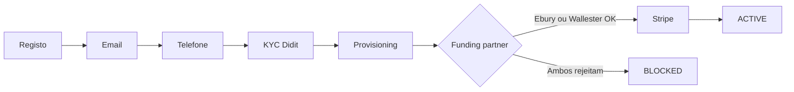

# Ciclo de vida da conta

## Objetivo

Entender os estados de uma conta desde o registo até poder movimentar dinheiro.

📖 **Texto de cada endpoint na ordem da jornada:** [Lógica do sistema](/docs/guides/logica-sistema)

## Visão geral



## Estados (`lifecycle.status`)

| Estado | Significado |
|--------|-------------|
| `PENDING_EMAIL_VERIFICATION` | Aguarda clique no link de email |
| `PENDING_PHONE_VERIFICATION` | Aguarda SMS |
| `PENDING_IDENTITY_VERIFICATION` | Precisa iniciar Didit |
| `IDENTITY_UNDER_REVIEW` | Didit em análise |
| `IDENTITY_REJECTED` | KYC recusado |
| `PROVISIONING` | A criar contas nos parceiros |
| `PENDING_EBURY_ONBOARDING` | Documentos corporate / Ebury |
| `EBURY_UNDER_REVIEW` | Ebury a analisar |
| `EBURY_REJECTED` | Ebury recusou (não bloqueia se Wallester OK) |
| `ACTIVE` | Pode transaccionar |
| `SUSPENDED` / `BLOCKED` | Conta bloqueada |

## Regra de activação (importante)

Uma conta **ACTIVE** exige:

1. **Um parceiro de funding aprovado** — **Ebury OU Wallester** (não precisas dos dois)
2. **Stripe** provisionado e pronto

Só fica **BLOCKED** se **ambos** Ebury e Wallester forem rejeitados.

## Passos e endpoints

### 1. Registo / login

- `POST /api/auth/register-retail` ou `POST /api/auth/login`
- Ler `lifecycle`, `capabilities`, `integrations` e `identity_verification` na resposta
- 📖 [Referência de cada campo](/docs/guides/auth-session)

### 2. Email

- Link no email **ou** `POST /api/customer/send-validation-email`

### 3. Telefone

- `POST /api/onboarding/phone/send` — sem `phone` reenvia para o número do registo; com outro número **ainda não verificado**, corrige a conta e envia para o novo
- `POST /api/onboarding/phone/validate` com `code`
- Número já verificado: `POST /api/customer/phone` + `/phone/confirm`

### 4. Identidade (KYC)

- `POST /api/kyc/identity/session` → redireccionar para `session_url`
- Webhook `POST /api/webhooks/didit` actualiza o estado

### 5. Provisioning (automático)

Após KYC aprovado, o backend provisiona **Wallester** e, quando um funding partner está aprovado, cria a conta **Stripe**.

**Ebury** está desactivado no código até estar pronto (`provisionEbury` comentado). A regra de `ACTIVE` continua a ser **Ebury OU Wallester** + Stripe — o caminho típico hoje é Wallester + Stripe.

Webhooks:

- `POST /api/webhooks/wallester`
- `POST /api/webhooks/stripe`
- `POST /api/webhooks/ebury` (quando Ebury voltar a ser usado)

### 6. ACTIVE

Quando `lifecycle.status === 'ACTIVE'` e `capabilities` permitirem:

- `POST /api/auth/create-pin` (PIN **só** com conta ACTIVE)
- `GET /api/wallet/dashboard`
- Top-up, P2P, gastos de cartão Wallester

📖 **Relacionado:** [Lógica do sistema](/docs/guides/logica-sistema) · [Conta pronta](/docs/guides/account-ready) · [Webhooks](/docs/guides/webhooks) · [Compras Wallester e câmbio](/docs/guides/wallester-card-movements)

## Corporate

Contas `corporate` podem precisar de:

- `POST /api/customer/create-corporate-responsible` — representante legal
- KYC Didit do responsável, depois KyB da empresa (`POST /api/kyc/identity/session`)

Não existe `POST /api/customer/submit-corporate-documents` na API actual.

## O que mostrar no app

Use sempre a resposta de login/registo:

```json
{
  "lifecycle": { "status": "PROVISIONING", "label": "...", "reason": null },
  "capabilities": { "can_transact": false, "blockers": [] },
  "integrations": {
    "stripe": { "status": "ACTIVE", "iban": { "iban": "DE89…", "bic": "…" } },
    "wallester": { "status": "PENDING", "iban": null },
    "ebury": { "status": "PENDING", "iban": null }
  },
  "identity_verification": null
}
```

Não hardcode a sequência — o backend é a fonte de verdade.
