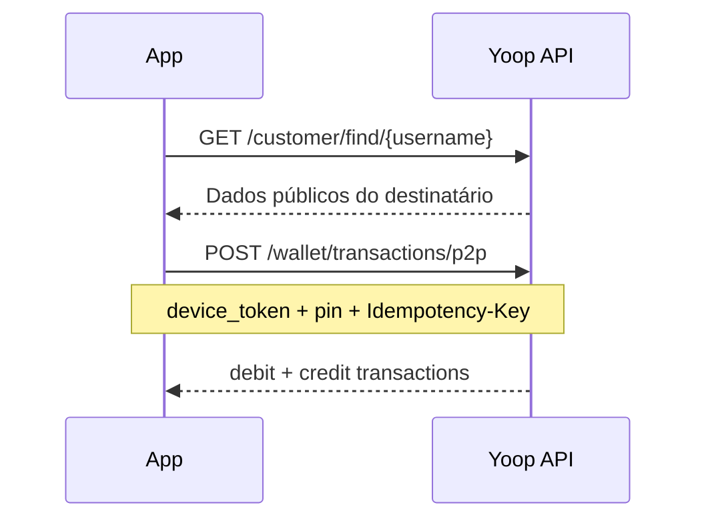

# Transferência P2P

## Objetivo

Enviar dinheiro de um utilizador para outro pelo `username`.

## Pré-requisitos

- Conta **ACTIVE** (tríade: email + KYC + lifecycle)
- PIN criado (`POST /api/auth/create-pin`) no dispositivo actual
- Saldo suficiente na moeda
- Header `Idempotency-Key` (UUID) no POST

O dinheiro move-se no **parceiro de funding (Wallester)**, não só no ledger local.

## Fluxo



## Passos

### 1. Confirmar destinatário (opcional)

```
GET /api/customer/find/janedoe
```

Devolve `name`, `username`, `avatar_url` — sem dados sensíveis.

### 2. Transferir

```
POST /api/wallet/transactions/p2p
Idempotency-Key: {uuid}
```

```json
{
  "recipient_username": "janedoe",
  "amount": 1000,
  "currency": "EUR",
  "description": "Almoço",
  "device_token": "DEVICE_TOKEN",
  "pin": "1234",
  "favorite": false
}
```

Resposta `201`:

```json
{
  "debit": { "id": 101, "direction": "debit", ... },
  "credit": { "id": 102, "direction": "credit", ... }
}
```

## Segurança

- `device_token` + `pin` validam que és tu no dispositivo registado
- Header `Idempotency-Key` obrigatório
- Não é possível transferir para o próprio username nem para contas `platform`
- `favorite: true` (opcional) guarda o destinatário em `GET /customer/favorites`
- Sem transferência: `POST /customer/favorites` (`{ "username": "janedoe" }`) e `DELETE /customer/favorites/{username}`

## Erros comuns

| HTTP | Motivo |
|------|--------|
| 404 | Destinatário não existe |
| 422 | PIN errado, saldo insuficiente, ou validação |
| 403 | Conta não elegível |

📖 **API:** `POST /wallet/transactions/p2p` na [referência](/docs) · [Lógica do sistema — P2P](/docs/guides/logica-sistema)
