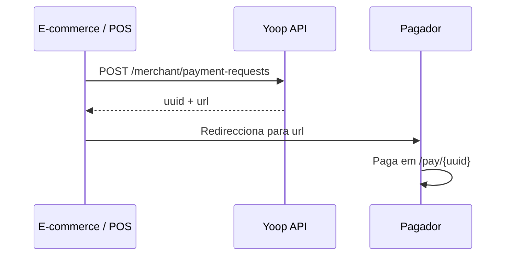

# Payment requests

## Objetivo

Criar um link de pagamento para um cliente final pagar na página Yoop (`/pay/{uuid}`).

## Autenticação

```
X-Merchant-Key: {api_key}
```

Sem Bearer token neste fluxo.

## Fluxo



## Criar pedido

```
POST /api/merchant/payment-requests
```

```json
{
  "amount": 5000,
  "description": "Order #123",
  "external_reference": "ORD-123",
  "callback_url": "https://loja.com/webhook/yoop",
  "expires_in": 60,
  "payment_method_types": ["card", "mbway"]
}
```

| Campo | Notas |
|-------|--------|
| `amount` | Cêntimos, mínimo 1 |
| `expires_in` | Minutos (5–1440), opcional. Se omitido, o pedido fica activo por **1 ano**. |
| `callback_url` | URL para notificação futura, opcional |
| `payment_method_types` | Opcional. Aceita `card` e/ou `mbway` (também `mb_way`). Também aceita `payment_method_type` singular. Se omitido, o PaymentIntent usa `automatic_payment_methods` e o Stripe mostra a selecção de métodos. |

Resposta `201`:

```json
{
  "uuid": "...",
  "url": "https://yoop.test/pay/...",
  "status": "pending",
  "amount": 5000,
  "currency": "EUR"
}
```

## Rate limit

10 pedidos/minuto (`stripe-intent`).

## Erros

| HTTP | Causa |
|------|--------|
| 401 | API key inválida |
| 422 | Validação |
| 429 | Rate limit |

📖 **API:** [referência parceiros](/docs/partners)
