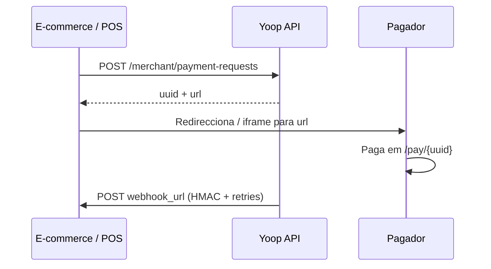

# Payment requests

## Objetivo

Criar um link de pagamento para um cliente final pagar na página Yoop (`/pay/{uuid}`).

## Autenticação

```http
X-Merchant-Key: {api_key}
```

Sem Bearer token neste fluxo. A `api_key` é fornecida na activação do merchant. A app do customer não regista nem mostra credenciais.

## Fluxo



## Criar pedido

```http
POST /api/merchant/payment-requests
```

```json
{
  "amount": 5000,
  "description": "Order #123",
  "external_reference": "ORD-123",
  "webhook_url": "https://loja.com/webhook/yoop",
  "expires_in": 60,
  "payment_method_types": ["card", "mb_way"],
  "items": [
    { "name": "Café", "quantity": 2, "unit_price": 150 },
    { "name": "Croissant", "quantity": 1, "unit_price": 200 }
  ]
}
```

| Campo | Notas |
|-------|--------|
| `amount` | Cêntimos, mínimo 1 |
| `expires_in` | Minutos (5–1440), opcional. Se omitido, o pedido fica activo por **1 ano**. |
| `webhook_url` | URL para notificação deste pedido (opcional; se omitido, usa o `webhook_url` do merchant) |
| `payment_method_types` | Opcional. Aceita `card` e/ou `mb_way` (aliases: `mbway`, `mb-way`). Também aceita `payment_method_type` singular. O valor enviado ao Stripe é sempre `mb_way`. Se omitido, a página de pagamento apresenta os métodos disponíveis automaticamente. |
| `items` | Opcional. Array de artigos a mostrar na página `/pay/{uuid}` (checkout). Se omitido, a secção de artigos não aparece. |

### `items` (opcional)

Cada elemento é um objecto nomeado:

| Campo | Tipo | Descrição |
|-------|------|-----------|
| `name` | string | Nome do artigo (exibido na página de pagamento) |
| `quantity` | number | Quantidade (mostrada como `N×`) |
| `unit_price` | integer | Preço unitário em **cêntimos** |

Na página de pagamento, se `items` for enviado, o pagador vê a lista (quantidade × nome e total da linha = `unit_price * quantity`).
Resposta `201`:

```json
{
  "uuid": "...",
  "url": "https://api.yooppayments.eu/pay/...",
  "status": "pending",
  "amount": 5000,
  "currency": "EUR"
}
```

A `url` (`/pay/{uuid}`) é a página a abrir no browser ou iframe.

## Embutir no site (iframe)

A página de pagamento mostra um **card** centrado:

| Dimensão | Valor |
|----------|--------|
| Largura máxima do card | **384px** (`max-w-sm`) |
| Altura do card | **dinâmica** (conteúdo: valor, `items`, formulário de pagamento, banner de teste) |

Recomendação para iframe:

| Atributo | Sugestão |
|----------|----------|
| `width` | **400** (ligeiramente acima dos 384px) |
| `height` | **640–720** (checkout simples); aumentar se houver muitos `items` |

```html
<iframe
  src="https://api.exemplo.com/pay/{uuid}?embed=1"
  title="Pagamento Yoop"
  width="400"
  height="720"
  style="border:0;max-width:100%;border-radius:16px;"
  allow="payment *"
></iframe>
```

### Comportamento em iframe (`?embed=1` ou detecção automática)

- A navegação após o pagamento **fica dentro do iframe** (ecrã de sucesso Yoop). Não há `window.top.location`.
- Em embed, a Yoop envia `postMessage` ao `parent` quando o pagamento conclui:

```js
window.addEventListener('message', (event) => {
  // Idealmente validar event.origin === 'https://api.exemplo.com'
  const data = event.data;
  if (!data || data.source !== 'yoop-pay') return;

  if (data.type === 'payment_request.completed') {
    // data.uuid — fechar modal / actualizar UI da loja
  }
});
```

| Campo | Descrição |
|-------|-----------|
| `source` | Sempre `yoop-pay` |
| `type` | `payment_request.completed` ou `payment_request.confirming` |
| `uuid` | UUID do payment request |
| `status` | `completed` / `processing` |

- Query opcional `return_url` (URL `http`/`https` absoluta): só é honrada em **full-page**. Em iframe é ignorada — use `postMessage` + UI da loja.
- Full-page exemplo: `/pay/{uuid}?return_url=https://loja.exemplo.com/obrigado`

Notas:

- Em mobile, use `width="100%"` (ou `max-width:100%`) e altura ≥ **720px**
- A página tem fundo cinza claro à volta do card; o iframe deve ter altura suficiente para não cortar o formulário de pagamento
- Preferir redirecionamento full-page se o site não precisar de checkout embutido
- Incluir `?embed=1` no `src` do iframe (recomendado) para o comportamento acima ficar explícito

## Webhook

Quando o pagamento fica `completed`, a Yoop envia `POST` para o `webhook_url` do pedido (ou, se não existir, o `webhook_url` do merchant).

### Headers

| Header | Descrição |
|--------|-----------|
| `X-Yoop-Timestamp` | Unix timestamp da assinatura |
| `X-Yoop-Signature` | `v1=` + HMAC-SHA256 hex |
| `X-Yoop-Delivery-Id` | UUID único desta tentativa de entrega |

### Assinatura HMAC

O `webhook_secret` é entregue na activação do merchant (**uma vez**). Guardem-no com segurança. A app do customer não volta a mostrá-lo nem a gerar outro.

```text
signed_payload = "{timestamp}.{raw_body}"
signature      = HMAC_SHA256(webhook_secret, signed_payload)
header         = "v1=" + signature
```

Validação na loja:

1. Rejeitar se `|now - timestamp| > 300` segundos
2. Recalcular HMAC com o body **raw** recebido
3. Comparar com `hash_equals` (comparação em tempo constante)
4. Usar `uuid` / `X-Yoop-Delivery-Id` para idempotência (há retries)

### Payload

```json
{
  "id": "evt_…",
  "type": "payment_request.completed",
  "created": 1716547200,
  "data": {
    "uuid": "…",
    "status": "completed",
    "settlement_status": "pending",
    "funds_available": false,
    "external_reference": "ORD-123",
    "amount": 5000,
    "fee_total": 200,
    "net_amount": 4800,
    "currency": "EUR",
    "paid_at": "…",
    "funds_available_at": "2026-07-28"
  }
}
```

| Campo | Significado |
|-------|-------------|
| `status` | Estado do pedido (`completed` = pago pelo cliente) |
| `amount` | Valor cobrado ao pagador (cêntimos) |
| `fee_total` | Soma das taxas descontadas (Stripe + plataforma), em cêntimos. `null` se ainda a calcular |
| `net_amount` | Valor líquido para o merchant (`amount - fee_total`), em cêntimos. `null` se ainda a calcular |
| `funds_available_at` | Data prevista (`YYYY-MM-DD`) em que os fundos ficam disponíveis. `null` se ainda desconhecida |
| `settlement_status` | `pending` = pago, fundos ainda a liquidar; `available` = disponíveis na wallet |
| `funds_available` | `true` quando os fundos já estão disponíveis para uso |

Notas:

- O primeiro webhook (logo após o pagamento) pode ter `fee_total` / `net_amount` / `funds_available_at` a `null` — as taxas chegam pouco depois via Stripe
- Quando as taxas e a data ficam conhecidas, a Yoop **reenvia** o webhook com os mesmos campos preenchidos (tratar com idempotência por `uuid`)

### Retries

Até **10** tentativas com backoff: 30s → 1m → 2m → 5m → 10m → 15m → 30m → 1h → 2h → 4h.

- **2xx** → sucesso  
- **4xx** (exceto 408/429) → sem retry (erro permanente)  
- **5xx / timeout / rede / 429** → nova tentativa  

## Rate limit

120 criações/minuto **por merchant** (não por IP). Resposta `429` com `Retry-After`.

## Erros

| HTTP | Causa |
|------|--------|
| 401 | API key inválida |
| 422 | Validação |
| 429 | Rate limit |

## Prompt para IA (copiar / colar)

Use o bloco abaixo num assistente de código (Cursor, ChatGPT, Claude, etc.) para gerar a integração.

````markdown
# Tarefa: integrar Yoop Payment Requests

Implementa a integração merchant Yoop no nosso backend (e, se fizer sentido, no frontend).

## Autenticação
- Todos os pedidos à API de parceiros usam o header: `X-Merchant-Key: {api_key}`
- Não uses Bearer/Sanctum nestes endpoints
- Base URL: `{YOOP_BASE_URL}/api` (ex.: `https://api.exemplo.com/api`)
- A `api_key` e o `webhook_secret` vêm da activação do merchant — guarda-os em secrets/env

## Criar pagamento
- `POST /merchant/payment-requests`
- Body JSON mínimo: `{ "amount": <cêntimos inteiros> }`
- Campos úteis: `description`, `external_reference`, `webhook_url`, `expires_in` (minutos 5–1440; omitir = ~1 ano), `payment_method_types` (`["card"]`, `["mb_way"]` ou ambos), `items` (array opcional de artigos para a página de pagamento)
- Se `webhook_url` for omitido no pedido, usa-se o `webhook_url` configurado no merchant
- `items` (opcional): lista de objectos `{ "name": string, "quantity": number, "unit_price": integer em cêntimos }`. Se enviado, é exibido na página `/pay/{uuid}` ao finalizar o pagamento; se omitido, a secção não aparece
- Resposta 201 inclui `uuid`, `url`, `status`, `amount`, `currency`
- Redirecciona (ou abre em iframe) o pagador para `url` (`/pay/{uuid}`)
- Iframe: card com largura máx. 384px; sugerido `width=400` `height=720` (altura dinâmica; aumentar com muitos items)

## Webhook de conclusão
- Quando `status` passa a `completed`, a Yoop faz POST para o `webhook_url` do pedido (ou do merchant)
- Headers: `X-Yoop-Timestamp`, `X-Yoop-Signature` (`v1=` + HMAC-SHA256 hex), `X-Yoop-Delivery-Id`
- Assinatura: `HMAC_SHA256(webhook_secret, "{timestamp}.{raw_body}")`
- Validar: rejeitar se |now - timestamp| > 300s; recalcular com body raw; comparar com hash_equals
- Tratar retries (até 10): ser idempotente por `data.uuid` ou `X-Yoop-Delivery-Id`
- Responder 2xx só depois de processar com sucesso; 4xx permanentes não são reintentados (exceto 408/429)

## Settlement no webhook
- `data.status=completed` = cliente pagou
- `amount` = valor cobrado; `fee_total` = taxas somadas; `net_amount` = líquido (`null` até fees confirmadas — há reenvio)
- `funds_available_at` = data prevista `YYYY-MM-DD`
- `data.settlement_status=pending` e `funds_available=false` = pago, fundos ainda a liquidar
- `settlement_status=available` / `funds_available=true` = fundos disponíveis

## Restrições
- Rate limit: 120 criações/minuto por merchant (tratar 429)
- Não inventes endpoints fora desta API de parceiros
- Não exponhas `api_key` / `webhook_secret` no frontend

## Entrega esperada
1. Cliente HTTP tipado (ou serviço) para criar payment request
2. Endpoint de webhook com verificação HMAC + idempotência
3. Fluxo UX: criar pedido → abrir `url` → marcar encomenda paga no webhook
4. Variáveis de ambiente documentadas: `YOOP_BASE_URL`, `YOOP_MERCHANT_API_KEY`, `YOOP_WEBHOOK_SECRET`
````

📖 **API:** [referência parceiros](/docs/partners) · [Prompt IA (guia)](/docs/partners/guides/ai-prompt) · [Lógica do sistema — merchant](/docs/guides/logica-sistema)
