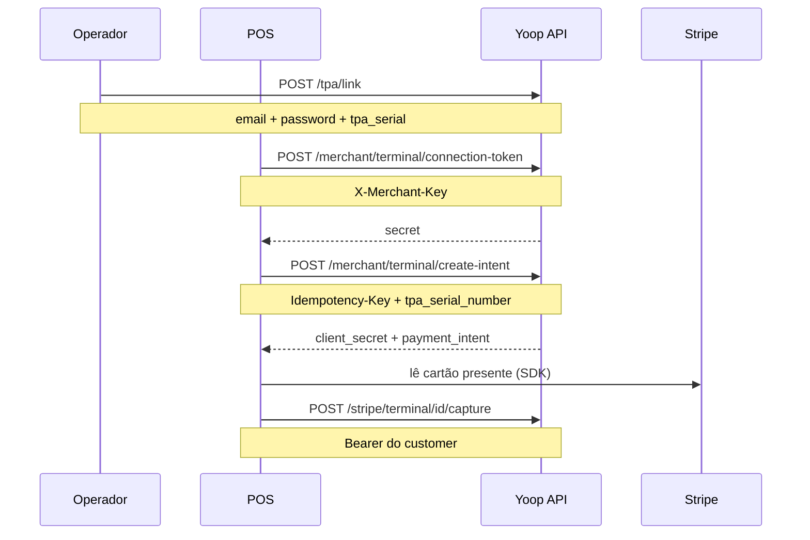

# Terminal (POS)

## Objetivo

Pagamento presencial via TPA (terminal) no ponto de venda.

Isto **não** é o top-up da wallet na app. Fluxo interno completo: [Lógica do sistema — Terminal / POS](/docs/guides/logica-sistema).

## Três autenticações — não misturar

| Passo | Quem chama | Auth |
|-------|------------|------|
| Pairing e login TPA | Operador / app Yoop | email + password (+ serial) — **sem** `X-Merchant-Key` |
| Connection token e create-intent | POS | `X-Merchant-Key` |
| Capture | Backend / sessão do **customer** dono | Bearer Sanctum + conta ACTIVE (email + KYC) |

O TPA fica ligado ao **customer** (`POST /api/tpa/link`). O merchant tem de ser desse mesmo customer: `tpa_serial_number` tem de existir em `tpas` com `customer_id` do dono da API key.

## Pré-requisitos

- Merchant registado e API key activa
- TPA com `serial` **active** ligado ao customer dono do merchant (`POST /api/tpa/link`)
- SDK de terminal no dispositivo POS

## Fluxo



Sessões seguintes do equipamento: `POST /api/auth/login-tpa` (não devolve `AuthSession` da app).

## 0. Emparelhar o TPA (uma vez)

```http
POST /api/tpa/link
```

```json
{
  "email": "dono@loja.com",
  "password": "…",
  "tpa_serial": "TPA-001"
}
```

Liga o serial ao customer. Sem isto, `create-intent` falha com serial inválido.

## 1. Connection token (POS)

```http
POST /api/merchant/terminal/connection-token
X-Merchant-Key: {api_key}
```

Body opcional: `{ "currency": "eur" }`

Resposta: `{ "secret": "..." }` → passar ao SDK do terminal.

## 2. Criar intent de pagamento (POS)

```http
POST /api/merchant/terminal/create-intent
X-Merchant-Key: {api_key}
Idempotency-Key: {uuid}
```

```json
{
  "tpa_serial_number": "TPA-001",
  "amount": 2000,
  "currency": "EUR"
}
```

Resposta `201`:

```json
{
  "client_secret": "pi_…_secret_…",
  "payment_intent": {
    "id": 55,
    "status": "requires_payment_method",
    "type": "card_present"
  }
}
```

Use `client_secret` no SDK para apresentar o pagamento no reader. O campo `payment_intent.id` é o **ID interno Yoop** — o mesmo que vai no capture.

## 3. Capturar

```http
POST /api/stripe/terminal/{paymentIntent}/capture
Authorization: Bearer {token_do_customer}
```

`{paymentIntent}` = `payment_intent.id` da resposta anterior. O token é Sanctum do **customer** dono (tríade ACTIVE), não a API key merchant.

Resposta: `{ "message": "Captura solicitada com sucesso." }`

## Erros comuns

| Erro | Causa |
|------|--------|
| `tpa_serial_number` inválido | Serial não existe, não está `active`, ou não pertence ao customer do merchant |
| 401 | API key inválida (passos 1–2) ou Bearer em falta (capture) |
| 403 | Capture: conta do customer ainda não elegível |
| 429 | Rate limit (120/min payment requests; 60/min connection-token e create-intent, **por merchant**) |
| Falta Idempotency-Key | Header obrigatório no create-intent |

## Prompt para IA (copiar / colar)

````markdown
# Tarefa: integrar Yoop Terminal (POS / TPA)

Implementa pagamentos presenciais com a API Yoop.

## Emparelhar (uma vez, credenciais do customer — não uses X-Merchant-Key)
- `POST /tpa/link` body `{ "email", "password", "tpa_serial" }`
- Sessões seguintes: `POST /auth/login-tpa` com os mesmos campos (`tpa_serial`)

## Autenticação no POS
- Header: `X-Merchant-Key: {api_key}`
- Base URL: `{YOOP_BASE_URL}/api`
- O TPA tem de estar ligado ao **mesmo customer** dono do merchant

## Fluxo de pagamento
1. `POST /merchant/terminal/connection-token` (body opcional `{ "currency": "eur" }`) → receber `secret`
2. Inicializar o SDK de terminal no POS com esse `secret`
3. `POST /merchant/terminal/create-intent` com header `Idempotency-Key` (UUID único por tentativa)
   - Body: `{ "tpa_serial_number": "<serial do TPA>", "amount": <cêntimos>, "currency": "EUR" }`
4. Usar `client_secret` da resposta no SDK para apresentar o cartão no reader
5. `POST /stripe/terminal/{payment_intent.id}/capture` com `Authorization: Bearer` do customer (conta ACTIVE)
6. Tratar erros: serial inválido, 401, 403, 422, 429; nunca reutilizar o mesmo Idempotency-Key para intents diferentes

## Restrições
- Não inventes endpoints
- Não mistures X-Merchant-Key com Bearer nos passos errados
- Guarda a API key só no backend/POS seguro
- Documenta env: `YOOP_BASE_URL`, `YOOP_MERCHANT_API_KEY`
- Rate limit: connection-token 60/min e create-intent 60/min **por merchant**; tratar 429
````

📖 **API:** [referência parceiros](/docs/partners) · [Lógica do sistema](/docs/guides/logica-sistema) · [Payment requests](/docs/partners/guides/payment-requests)
