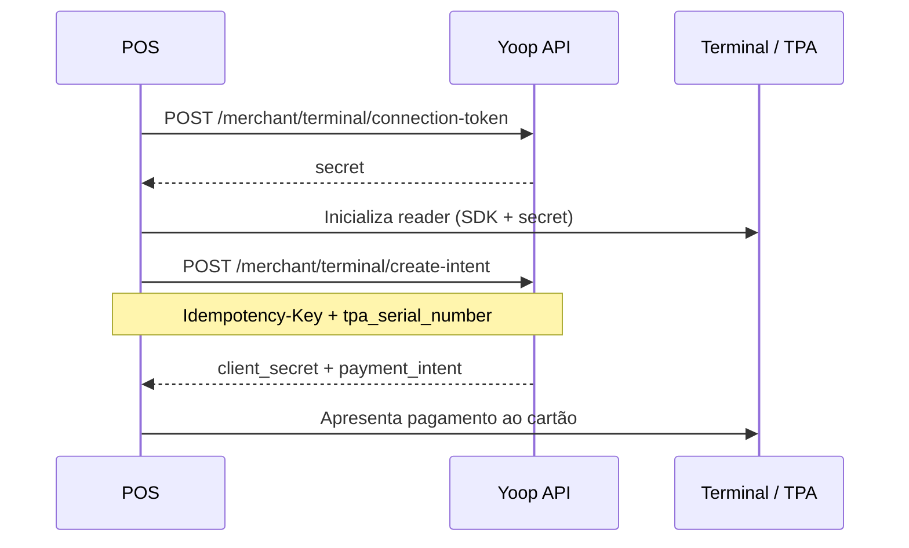

# Terminal (POS)

## Objetivo

Pagamento presencial via TPA (terminal) no ponto de venda.

## Autenticação

```http
X-Merchant-Key: {api_key}
```

## Pré-requisitos

- Merchant registado e API key activa
- TPA com `serial` activo ligado ao merchant
- SDK de terminal no dispositivo POS

## Fluxo



## 1. Connection token

```http
POST /api/merchant/terminal/connection-token
```

Body opcional: `{ "currency": "eur" }`

Resposta: `{ "secret": "..." }` → passar ao SDK do terminal.

## 2. Criar intent de pagamento

```http
POST /api/merchant/terminal/create-intent
Idempotency-Key: {uuid}
```

```json
{
  "tpa_serial_number": "TPA-001",
  "amount": 2000,
  "currency": "EUR"
}
```

Resposta `201`:

```json
{
  "client_secret": "pi_…_secret_…",
  "payment_intent": {
    "id": 55,
    "status": "requires_payment_method",
    "type": "card_present"
  }
}
```

Use `client_secret` no SDK para apresentar o pagamento no reader. O campo `payment_intent.id` é o **ID interno Yoop**.

## Erros comuns

| Erro | Causa |
|------|--------|
| `tpa_serial_number` inválido | Serial não existe ou não pertence ao merchant |
| 429 | Rate limit |
| Falta Idempotency-Key | Header obrigatório no create-intent |

## Prompt para IA (copiar / colar)

````markdown
# Tarefa: integrar Yoop Terminal (POS / TPA)

Implementa pagamentos presenciais com a API Yoop de parceiros.

## Autenticação
- Header: `X-Merchant-Key: {api_key}`
- Base URL: `{YOOP_BASE_URL}/api`

## Fluxo
1. `POST /merchant/terminal/connection-token` (body opcional `{ "currency": "eur" }`) → receber `secret`
2. Inicializar o SDK de terminal no POS com esse `secret`
3. `POST /merchant/terminal/create-intent` com header `Idempotency-Key` (UUID único por tentativa)
   - Body: `{ "tpa_serial_number": "<serial do TPA>", "amount": <cêntimos>, "currency": "EUR" }`
4. Usar `client_secret` da resposta no SDK para apresentar o cartão no reader
5. Tratar erros: serial inválido, 401, 422, 429; nunca reutilizar o mesmo Idempotency-Key para intents diferentes

## Restrições
- Não inventes endpoints
- Guarda a API key só no backend/POS seguro
- Documenta env: `YOOP_BASE_URL`, `YOOP_MERCHANT_API_KEY`
````

📖 **API:** [referência parceiros](/docs/partners) · [Payment requests](/docs/partners/guides/payment-requests)
