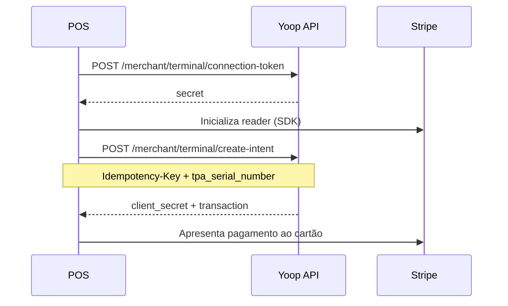

# Terminal (POS)

## Objetivo

Top-up presencial via TPA com Stripe Terminal SDK.

## Autenticação

```
X-Merchant-Key: {api_key}
```

## Pré-requisitos

- Merchant registado e API key activa
- TPA com `serial` activo ligado ao merchant
- Stripe Terminal SDK no dispositivo

## Fluxo



## 1. Connection token

```
POST /api/merchant/terminal/connection-token
```

Body opcional: `{ "currency": "eur" }`

Resposta: `{ "secret": "..." }` → passar ao Terminal SDK.

## 2. Criar PaymentIntent

```
POST /api/merchant/terminal/create-intent
Idempotency-Key: {uuid}
```

```json
{
  "tpa_serial_number": "TPA-001",
  "amount": 2000,
  "currency": "EUR"
}
```

Resposta `201`:

```json
{
  "client_secret": "pi_...",
  "transaction": { "id": 55, ... }
}
```

## 3. Captura (fluxo cliente app)

Se o pagamento for criado pelo **app do customer** (não merchant key), a captura usa:

```
POST /api/stripe/terminal/{transaction_id}/capture
Authorization: Bearer {token}
```

## Erros comuns

| Erro | Causa |
|------|--------|
| `tpa_serial_number` inválido | Serial não existe ou não pertence ao merchant |
| 429 | Rate limit |
| Falta Idempotency-Key | Header obrigatório no create-intent |

📖 **API:** [referência parceiros](/docs/partners) · [Top-up cartão](/docs/guides/topup-card) (webhook igual)
