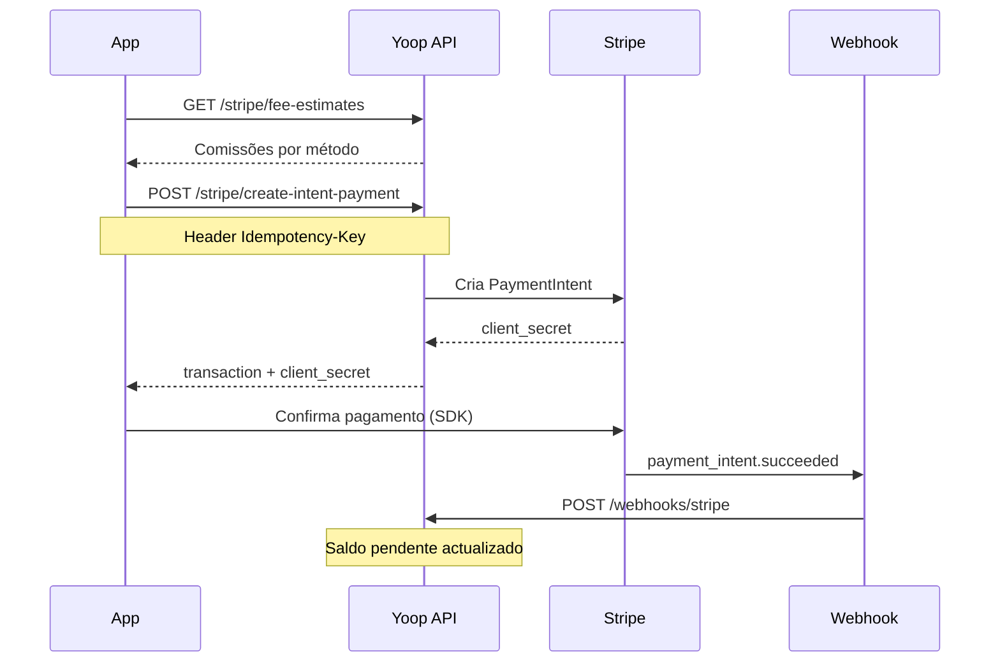

# Top-up com cartão

## Objetivo

Carregar saldo na wallet usando Stripe (cartão ou método configurado).

> Documentação técnica alargada: ver também `docs/STRIPE_FLOW.md` no repositório.

## As 3 fases do dinheiro

| Fase | O quê | Tempo típico |
|------|--------|--------------|
| 1 | Criar PaymentIntent + cliente paga na Stripe | segundos |
| 2 | Webhook confirma → saldo **pendente** | minutos |
| 3 | Settlement → saldo **disponível** | D+2 (configurável) |

## Pré-requisitos

- Conta **ACTIVE** ([checklist](/docs/guides/account-ready))
- Token Sanctum
- Conta Stripe do customer provisionada

## Fluxo completo



## Passo a passo

### 1. Mostrar custos (opcional)

```
GET /api/stripe/fee-estimates?currency=EUR
```

Devolve taxa plataforma + Stripe por método de pagamento.

### 2. Listar métodos

```
GET /api/stripe/payment-methods?currency=EUR
```

Escolher `payment_method_id` para o passo seguinte.

### 3. Criar PaymentIntent

```
POST /api/stripe/create-intent-payment
Idempotency-Key: {uuid}
```

Body:

```json
{
  "amount": 10000,
  "payment_method_id": 1,
  "currency": "eur"
}
```

`amount` em **cêntimos** (10000 = 100,00 €).

Resposta `201`:

```json
{
  "transaction": { "id": 42, "status": "pending", ... },
  "client_secret": "pi_xxx_secret_yyy"
}
```

### 4. Confirmar na Stripe (app)

Usar Stripe.js / mobile SDK com `client_secret`. **A Yoop não vê o cartão** — só a Stripe.

### 5. Webhook (assíncrono)

A Stripe chama:

```
POST /api/webhooks/stripe
```

O backend:

1. Encontra a transação pelo `payment_intent` id
2. Marca como `succeeded`
3. Calcula taxas (Stripe + plataforma)
4. Credita saldo **pendente**

### 6. Consultar resultado

```
GET /api/wallet/transactions/{id}
GET /api/wallet/dashboard
```

## Headers obrigatórios

| Header | Valor |
|--------|--------|
| `Authorization` | `Bearer {token}` |
| `Idempotency-Key` | UUID único por tentativa |
| `Content-Type` | `application/json` |

## Rate limit

`10` pedidos/minuto por utilizador (`stripe-intent`). Resposta `429` se exceder.

## Erros comuns

| Situação | O que fazer |
|----------|-------------|
| 403 | Conta não elegível — ver [account-ready](/docs/guides/account-ready) |
| 422 | `payment_method_id` inválido ou `amount` &lt; 1 |
| Pagamento OK mas saldo não muda | Aguardar webhook; verificar logs `stripe` |
| Retry após falha | **Novo** `Idempotency-Key` |

📖 **API:** [Stripe no Scalar](/docs) · [Webhooks](/docs/guides/webhooks)
