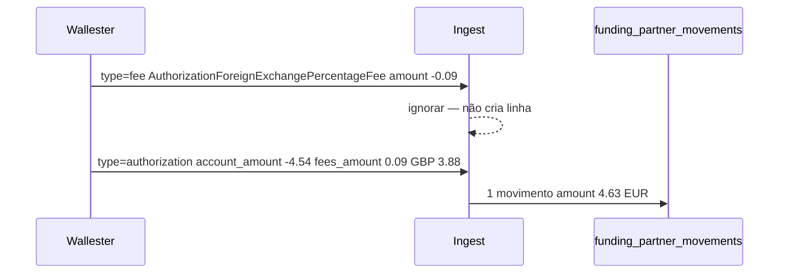

# Compras Wallester e câmbio

## Objetivo

Perceber como a Yoop regista gastos de cartão Wallester em `funding_partner_movements` — **um movimento por compra**, mesmo quando a Wallester envia dois webhooks (compra + taxa FX).

## Onde vive o dado

| Superfície | O quê |
|---|---|
| Tabela | `funding_partner_movements` |
| API customer | `GET /api/wallet/funding-accounts/{id}/movements` |
| API live Wallester | `GET /api/wallester/transactions` (passthrough — **não** é esta tabela) |
| Backoffice | Transacções → tab Wallester; timeline do cliente |
| Ledger | `CARD_PURCHASE` / `CARD_UNLOAD` com o **total** debitado na conta |

## Dois webhooks, um movimento

Numa compra em moeda estrangeira a Wallester envia **dois** eventos no mesmo segundo. A taxa chega **primeiro**.



Ligação: `fee.data.authorization_id` = `authorization.data.id`.

O payload da autorização **já traz** `fees_amount`. Não é preciso esperar pelo webhook `fee` nem fundir depois.

## Campos (cêntimos)

Exemplo Lidl GB (compra 3,88 GBP, conta EUR):

| Campo | Valor | Origem |
|---|---|---|
| `amount` | `463` (4,63 EUR) | `\|account_amount\| + \|fees_amount\|` — total que sai da conta |
| `currency` | `EUR` | `account_currency_code` (moeda da conversão) |
| `fees_amount` | `9` (0,09 EUR) | `fees_amount` — valor do câmbio, na moeda da conta |
| `original_amount` | `388` (3,88 GBP) | `\|transaction_amount\|` |
| `original_currency` | `GBP` | `transaction_currency_code` |

Não gravamos rácio (`fx_rate`). Compra na mesma moeda, sem taxa: `amount` = `|account_amount|`, `fees_amount` vazio.

O ledger usa `amount` (o total). Settlement posterior da mesma compra **não** altera `amount` nem volta a debitar.

## API

`GET /api/wallet/funding-accounts/{id}/movements` devolve, entre outros:

```json
{
  "amount": 463,
  "currency": "EUR",
  "original_amount": 388,
  "original_currency": "GBP",
  "fees_amount": 9,
  "type": "card_purchase",
  "direction": "out",
  "description": "LidlGB"
}
```

No backoffice o montante é o total (`4,63 EUR`); se houver câmbio aparece `3,88 GBP · câmbio 0,09 EUR`.

## Comandos

| Comando | Função |
|---|---|
| `wallester:sync-card-movements` | Fallback ao webhook — importa transacções de cartão em falta (schedule 00:00 e 12:00) |
| `wallester:normalize-fx-fee-purchases {--customer=}` | One-shot: converte linhas antigas que gravaram **só a taxa** (a compra ficou em `settlement_metadata`) no movimento unificado e lança o complemento no ledger |

Código: `WallesterCardMovementIngestService`, `WallesterCardMovementPayloadMapper`, `NormalizeSwallowedWallesterFxPurchasesService`.

📖 **Relacionado:** [Webhooks](/docs/guides/webhooks) · [Ciclo de vida](/docs/guides/onboarding-lifecycle)
