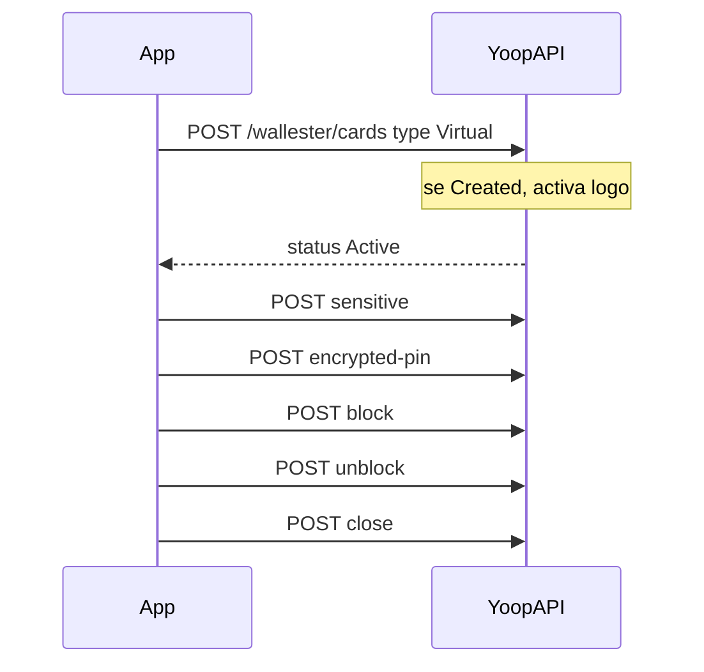
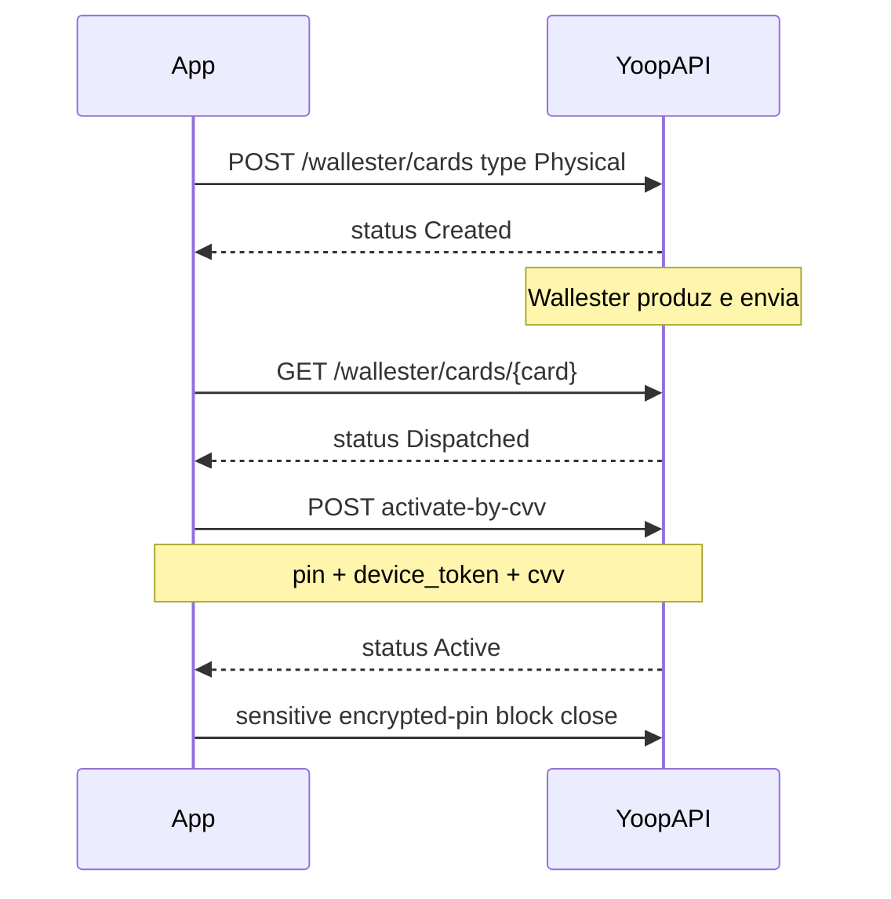

# Cartões Wallester

## Objetivo

Emitir e gerir cartões na app: primeiro o **virtual** (já sai activo), depois o **físico** (activar com o CVV impresso).

Virtual e físico usam o **mesmo** endpoint de criação. A diferença é o `type` e, no físico, a morada de entrega + `activate-by-cvv`.

Contrato JSON: [Wallester no Scalar](/docs). Referência contínua: [Lógica do sistema — cartões](/docs/guides/logica-sistema).

## Pré-requisitos

- Conta **ACTIVE** ([checklist](/docs/guides/account-ready))
- Conta Wallester `ACTIVE`
- PIN criado neste dispositivo (`POST /api/auth/create-pin`)
- Bearer Sanctum

Cotação opcional (mostrar taxa antes de emitir):

```
GET /api/wallester/cards/issuance-quote
```

Virtual só cobra se **já** existir um cartão aberto. Físico cobra sempre que a taxa configurada for &gt; 0.

## Um endpoint, dois produtos

```
POST /api/wallester/cards
```

| `type` | O que acontece na criação | Próximo passo na app |
|--------|---------------------------|----------------------|
| `Virtual` | Se vier `Created`, o backend **activa logo**. A resposta sai `Active`. | Revelar dados, congelar, fechar |
| `Physical` | Fica `Created`. A Wallester produz e envia até `Dispatched`. | Activar com CVV impresso |

O `{card}` nos paths seguintes é o **ID local** (`customer_wallester_cards.id`), não o UUID Wallester.

---

## 1. Cartão virtual

O cartão virtual **já sai activado**. A app **não** chama `POST /wallester/cards/{card}/activate` no fluxo normal — esse endpoint só existe se a criação não tiver activado.



### 1.1 Criar

```
POST /api/wallester/cards
```

```json
{
  "type": "Virtual",
  "name": "Cartão principal",
  "pin": "1234",
  "device_token": "DEVICE_TOKEN"
}
```

Resposta `201` — `status` é `Active`. Guardar `id` para os passos seguintes.

`pin` + `device_token` são o PIN da **app** neste dispositivo, não o PIN do cartão.

### 1.2 Revelar número e CVV

Só em `Active` ou `Blocked`. Tratar o ecrã como dados sensíveis.

```
POST /api/wallester/cards/{card}/sensitive
```

Com password da conta:

```json
{
  "password": "senha-de-login"
}
```

Ou com PIN do device:

```json
{
  "pin": "1234",
  "device_token": "DEVICE_TOKEN"
}
```

Resposta: `card_number`, `cvv`, `expiry_date`.

### 1.3 Revelar PIN do cartão

Não confundir com o PIN da app. Pré-requisitos iguais a `sensitive`.

```
POST /api/wallester/cards/{card}/encrypted-pin
```

O body é o mesmo (password **ou** `pin` + `device_token`). Resposta: `{ "pin": "1234" }` — PIN impresso / do cartão.

### 1.4 Congelar (freeze)

Congela um cartão `Active`. Idempotente se já estiver `Blocked`.

```
POST /api/wallester/cards/{card}/block
```

```json
{
  "pin": "1234",
  "device_token": "DEVICE_TOKEN"
}
```

Com o cartão congelado ainda se pode revelar dados e descongelar.

### 1.5 Descongelar

```
POST /api/wallester/cards/{card}/unblock
```

O body é o mesmo (`pin` + `device_token`). Só em `Blocked`. Idempotente se já `Active`.

Isto **não** activa um cartão físico em `Dispatched`. Activar físico é `activate-by-cvv`.

### 1.6 Fechar (bloquear definitivamente)

Encerra o cartão (`Closed` / `Closing`). Irreversível do ponto de vista de produto. Depois disto, nenhuma acção de gestão.

```
POST /api/wallester/cards/{card}/close
```

```json
{
  "pin": "1234",
  "device_token": "DEVICE_TOKEN"
}
```

Só `Active` ou `Blocked`.

---

## 2. Cartão físico

O plástico **não** sai activo. A app cria, espera o envio (`Dispatched`) e o utilizador activa com o **CVV impresso** + PIN da app.



### 2.1 Criar

O mesmo `POST /api/wallester/cards`, com `type: Physical` e morada de entrega.

```
POST /api/wallester/cards
```

```json
{
  "type": "Physical",
  "name": "Cartão de viagem",
  "pin": "1234",
  "device_token": "DEVICE_TOKEN",
  "delivery_address": {
    "first_name": "João",
    "last_name": "Silva",
    "address": "Rua das Flores, 1",
    "city": "Lisboa",
    "state": "Lisboa",
    "country": "PT",
    "postal_code": "1000-001",
    "phone": "+351912345678"
  }
}
```

`country` é ISO alpha-2 (`PT`). A morada **não** é enviada à Wallester — fica na Yoop.

Resposta `201` — `status` é `Created` (pendente de envio). Sem botões de revelar / bloquear nesta fase.

### 2.2 Esperar o envio

```
GET /api/wallester/cards
GET /api/wallester/cards/{card}
```

A lista é local (`managed()`). O detalhe é live Wallester — usar o `status` desta resposta para os botões.

Quando `status` for `Dispatched` (o plástico chegou / foi enviado), a única acção é activar com CVV.

### 2.3 Activar com CVV

```
POST /api/wallester/cards/{card}/activate-by-cvv
```

```json
{
  "pin": "1234",
  "device_token": "DEVICE_TOKEN",
  "cvv": "123"
}
```

- `pin` — PIN da **app** (4 dígitos)
- `cvv` — os 3 dígitos **impressos no cartão**, em claro. O servidor cifra antes de enviar à Wallester
- Aceite em `Dispatched`, `Created` e `Personalized`. Idempotente se já `Active`
- Não usar em `Blocked` (isso é `unblock`) nem em `Closed`

Depois da resposta, o cartão está `Active`. A partir daqui o fluxo é o mesmo do virtual: revelar dados, PIN do cartão, congelar, descongelar, fechar (secções 1.2–1.6).

---

## Estados e botões

| Status | Acções |
|--------|--------|
| `Active` | Revelar dados e PIN, congelar, fechar |
| `Blocked` | Revelar dados e PIN, descongelar, fechar |
| `Dispatched` | Só `activate-by-cvv` |
| `Created` (físico) | Nenhuma — à espera do envio |
| `Closed` / `Closing` | Nenhuma |

Listar e detalhar:

```
GET /api/wallester/cards
GET /api/wallester/cards/{card}
```

## Erros comuns

| HTTP | Motivo |
|------|--------|
| 403 | Conta não elegível (tríade) ou cartão de outro customer |
| 404 | Cartão local inexistente |
| 422 | PIN errado, CVV inválido, tipo/estado errado (ex. `block` num `Dispatched`, `activate-by-cvv` num Virtual, `sensitive` num `Closed`) |

📖 **API:** [Wallester no Scalar](/docs) · [Lógica do sistema — cartões](/docs/guides/logica-sistema) · [Compras e câmbio](/docs/guides/wallester-card-movements)
