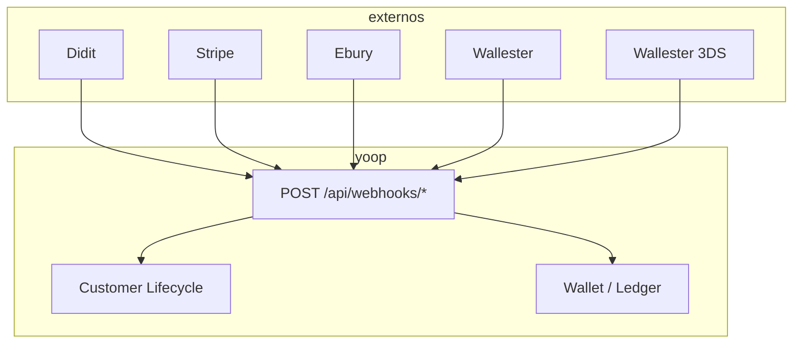

# Webhooks (inbound)

## Objetivo

Perceber o que cada webhook externo altera no sistema — **não são endpoints que vocês chamam**, são os parceiros que chamam a Yoop.

## URLs (estáveis)

| Parceiro | URL |
|----------|-----|
| Didit (KYC) | `POST /api/webhooks/didit` |
| Stripe | `POST /api/webhooks/stripe` |
| Ebury | `POST /api/webhooks/ebury` |
| Wallester (conta / cartão) | `POST /api/webhooks/wallester` |
| Wallester 3DS | `POST /api/webhooks/wallester/3ds/initiate-action-event` |
| Wallester 3DS validate | `POST /api/webhooks/wallester/3ds/validate-event` |

## Didit — identidade

**Quando:** utilizador conclui fluxo KYC.

**Efeito típico:**

- Aprovado → provisiona **Wallester** (Ebury está desactivado no código até estar pronto), avança lifecycle para `PROVISIONING`
- Recusado → `IDENTITY_REJECTED`

**Doc interna:** equipa de infra configura URL no painel Didit.

## Stripe — pagamentos

**Quando:** PaymentIntent confirmado, charge, etc.

**Evento chave:** `payment_intent.succeeded`

**Efeito:**

1. Actualiza transação na BD
2. Calcula taxas
3. Credita saldo pendente do customer

Ver [Top-up com cartão](/docs/guides/topup-card).

## Ebury — funding partner

**Quando:** onboarding / revisão de documentos corporate.

**Efeito:**

- Aprovado → pode activar conta se Stripe + (outro partner) OK
- Rejeitado → `EBURY_REJECTED` — **não bloqueia** se Wallester estiver activo

## Wallester — funding partner e gastos de cartão

**Quando:** conta cartão/IBAN provisionada, alteração de estado, autorização/transacção de cartão, ou taxa FX.

**Efeito — conta:**

- `active` → contribui para activação com Stripe
- `rejected` → se Ebury também rejeitado → `BLOCKED`

**Efeito — cartão:** o ingest grava compras/reembolsos em `funding_partner_movements` e debita o ledger.

Numa compra com câmbio chegam **dois** webhooks; a Yoop unifica-os num só movimento (total = compra convertida + taxa). O webhook `type=fee` (`AuthorizationForeignExchangePercentageFee`) **não** cria linha.

Ver [Compras Wallester e câmbio](/docs/guides/wallester-card-movements).

## Wallester 3DS

**Quando:** compra online que exige confirmação na app.

1. `POST /api/webhooks/wallester/3ds/initiate-action-event` — cria challenge `Pending`
2. A app lista/aprova/rejeita em `/api/wallester/3ds-challenges/*`
3. `POST /api/webhooks/wallester/3ds/validate-event` — Wallester pergunta se já há decisão

Fluxo completo: [Lógica do sistema — 3DS](/docs/guides/logica-sistema).

## Diagrama simplificado

## Notas para desenvolvimento

- Webhooks são **assíncronos** — o app deve fazer polling ou refresh após pagamento/KYC
- Em local, usar Stripe CLI / túneis para testar
- Não documentar webhooks na API pública de parceiros — só uso interno

📖 **Relacionado:** [Lógica do sistema](/docs/guides/logica-sistema) · [Ciclo de vida](/docs/guides/onboarding-lifecycle) · [Compras Wallester e câmbio](/docs/guides/wallester-card-movements)
