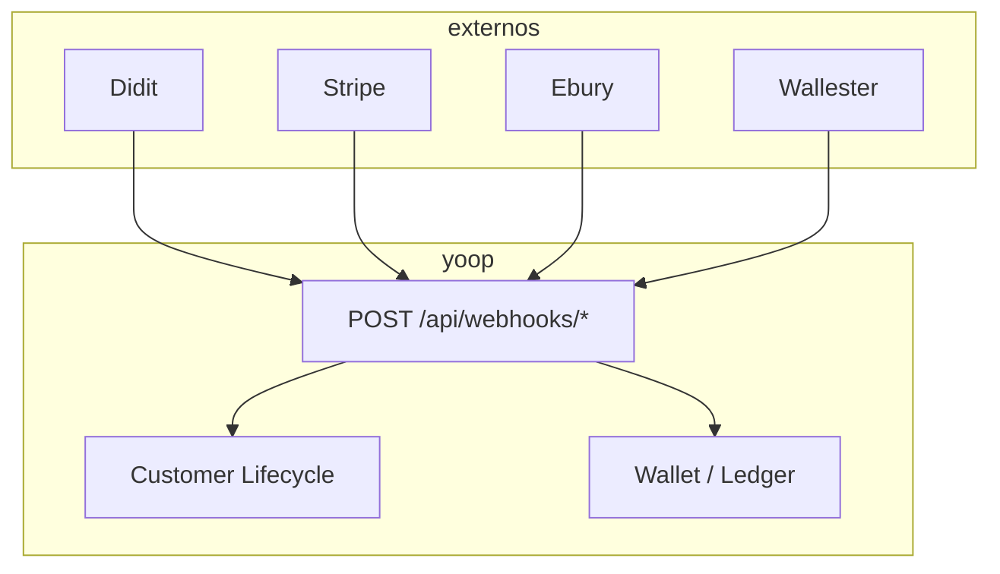

# Webhooks (inbound)

## Objetivo

Perceber o que cada webhook externo altera no sistema — **não são endpoints que vocês chamam**, são os parceiros que chamam a Yoop.

## URLs (estáveis)

| Parceiro | URL |
|----------|-----|
| Didit (KYC) | `POST /api/webhooks/didit` |
| Stripe | `POST /api/webhooks/stripe` |
| Ebury | `POST /api/webhooks/ebury` |
| Wallester | `POST /api/webhooks/wallester` |

## Didit — identidade

**Quando:** utilizador conclui fluxo KYC.

**Efeito típico:**

- Aprovado → submete Ebury, provisiona Wallester, avança lifecycle
- Recusado → `IDENTITY_REJECTED`

**Doc interna:** equipa de infra configura URL no painel Didit.

## Stripe — pagamentos

**Quando:** PaymentIntent confirmado, charge, etc.

**Evento chave:** `payment_intent.succeeded`

**Efeito:**

1. Actualiza transação na BD
2. Calcula taxas
3. Credita saldo pendente do customer

Ver [Top-up com cartão](/docs/guides/topup-card).

## Ebury — funding partner

**Quando:** onboarding / revisão de documentos corporate.

**Efeito:**

- Aprovado → pode activar conta se Stripe + (outro partner) OK
- Rejeitado → `EBURY_REJECTED` — **não bloqueia** se Wallester estiver activo

## Wallester — funding partner

**Quando:** conta cartão/IBAN provisionada ou alteração de estado.

**Efeito:**

- `active` → contribui para activação com Stripe
- `rejected` → se Ebury também rejeitado → `BLOCKED`

## Diagrama simplificado

## Notas para desenvolvimento

- Webhooks são **assíncronos** — o app deve fazer polling ou refresh após pagamento/KYC
- Em local, usar Stripe CLI / túneis para testar
- Não documentar webhooks na API pública de parceiros — só uso interno

📖 **Relacionado:** [Ciclo de vida](/docs/guides/onboarding-lifecycle)
